<picture>
  <source media="(prefers-color-scheme: dark)" srcset="docs/media/readme/banner-dark.svg">
  <source media="(prefers-color-scheme: light)" srcset="docs/media/readme/banner-light.svg">
  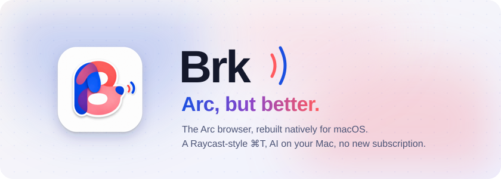
</picture>

<p align="center">
  <a href="https://github.com/cyang2020/brk/releases/tag/latest"></a>
</p>

<p align="center">
  
  
  
  
  <a href="LICENSE"></a>
</p>

<p align="center">
  <a href="#t-upgraded">⌘T, upgraded</a> ·
  <a href="#everyday-upgrades">Everyday upgrades</a> ·
  <a href="#ai-on-your-mac">AI on your Mac</a> ·
  <a href="#more-ai-better-than-dia">More AI</a> ·
  <a href="#arc-pixel-for-pixel">Arc, pixel for pixel</a> ·
  <a href="#not-in-brk-yet">Not yet</a>
</p>

<picture>
  <source media="(prefers-color-scheme: dark)" srcset="docs/media/readme/features-dark.svg">
  <source media="(prefers-color-scheme: light)" srcset="docs/media/readme/features-light.svg">
  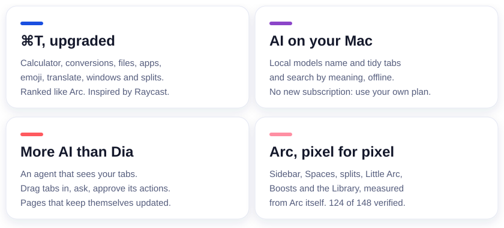
</picture>

<p align="center">
  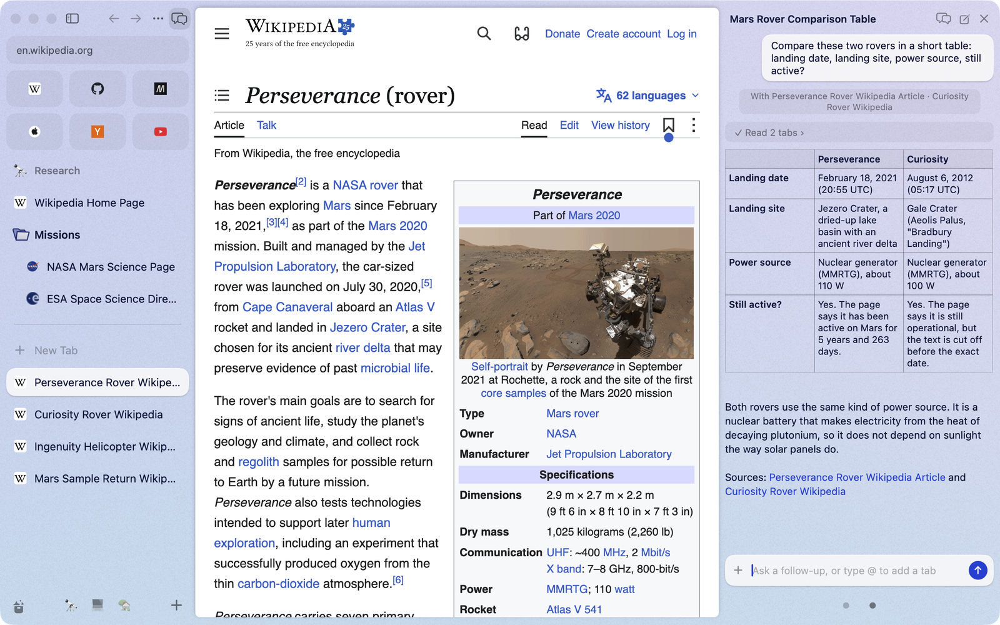
</p>

Everything you know from Arc is here: the sidebar, Spaces, Favorites, Pinned tabs, split view, Little Arc, Peek, Boosts, the Library, the command bar and the shortcuts. Brk rebuilds Arc 1.170 feature by feature, from Arc's own measurements. On top of that it adds the things Arc never had.

<picture>
  <source media="(prefers-color-scheme: dark)" srcset="docs/media/readme/divider-dark.svg">
  <source media="(prefers-color-scheme: light)" srcset="docs/media/readme/divider-light.svg">
  
</picture>

## ⌘T, upgraded

<p align="center">
  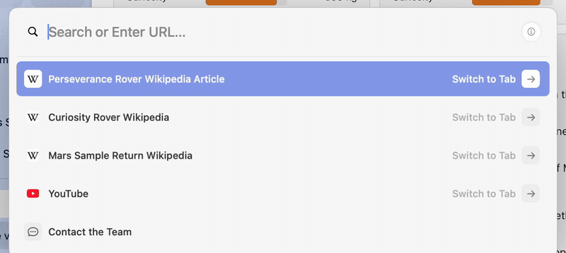
</p>

Inspired by Raycast, the command bar does much more than open pages. Type, and the answer is already there. Type a word and press **Tab** to switch the bar into a mode.

| Type | You get |
| --- | --- |
| `2^10 * 3`, `15% of 240` | The answer in the bar. Return copies it. |
| `100 usd in eur`, `5 km in miles`, `time in tokyo` | Currency, unit and time-zone conversions. |
| `file` + Tab, then a name or what the file is about | Files on your Mac, by name or by meaning, from a local index: a query takes about 20 ms. Return opens, ⌘Return reveals in Finder, ⌥Return copies the path. |
| `app` + Tab, or just the app's name | Open any app. |
| `emoji` + Tab | Find an emoji and copy it. |
| `translate` + Tab | Translate text, or the whole page. |
| `define` + Tab | The macOS dictionary. |
| `color` + Tab, or `#ff5500` | A colour in hex, RGB and HSL. |
| `window` + Tab, or `left half` | Put the window on a half, centre it, maximise it or move it to the next display. |
| `split` + Tab | Open a tab or a page beside the current one. |
| `claude`, `gpt`, `gemini`, `cursor` + Tab | Ask that agent, with the current tab attached. |
| `page`, `summarize` + Tab | Ask about the page you are on, or summarise it. |
| A site's name + Tab | Search inside that site. |
| A command, such as `dark mode` or `new space` | Run it. Every menu command is reachable by name. |
| Words from an old AI conversation | Find the conversation and continue it. |

Most modes also answer to Chinese words: 问, 翻译, 查, 分屏, 窗口, 文件, 应用, 表情, 算, 颜色.

The ordinary results (open tabs, history, suggestions, top sites) are ranked by a port of Arc's own scoring, so the first row is the one Arc would pick. It learns from you: pages you type often and commands you run rise to the top.

<picture>
  <source media="(prefers-color-scheme: dark)" srcset="docs/media/readme/divider-dark.svg">
  <source media="(prefers-color-scheme: light)" srcset="docs/media/readme/divider-light.svg">
  
</picture>

## Everyday upgrades

<p align="center">
  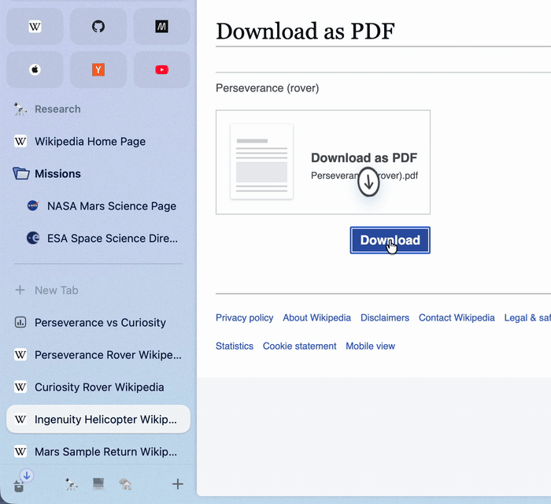
</p>

**Downloads where you look.** A new download flies from your click into the Library button. Rest the pointer on the button to see your four newest downloads and captures, with progress, preview and drag-out.

<p align="center">
  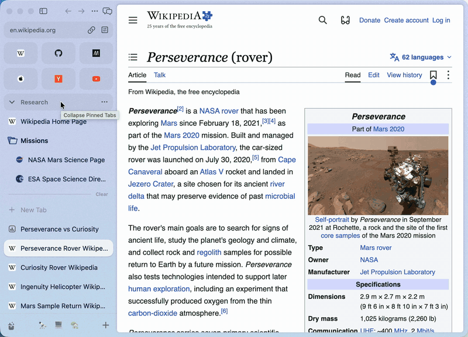
</p>

**Your mouse works everywhere.** Back and forward buttons and mouse-driver swipes go back and forward over a page and switch Spaces over the sidebar. ⇧⌘] and ⇧⌘[ step through tabs, and a middle-click on a tab closes it.

<picture>
  <source media="(prefers-color-scheme: dark)" srcset="docs/media/readme/divider-dark.svg">
  <source media="(prefers-color-scheme: light)" srcset="docs/media/readme/divider-light.svg">
  
</picture>

## AI on your Mac

<p align="center">
  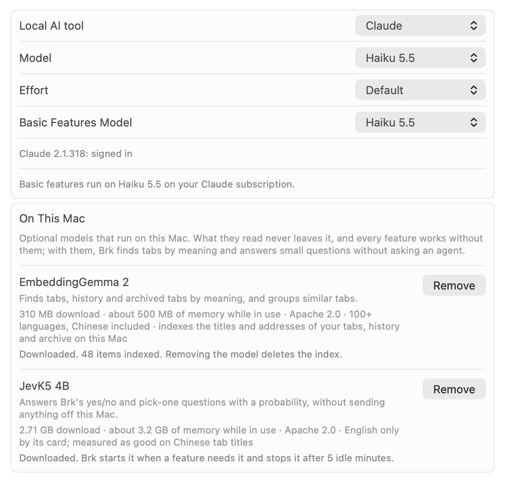
</p>

**No new subscription.** Brk uses the Claude Code or Codex already installed on your Mac, signed in to the Claude or ChatGPT plan you already pay for. No API key and no Brk account.

**The small jobs never leave your Mac.** Naming tabs and groups, tidying Today into groups and spotting duplicate tabs can run on small models on your Mac (Settings → Max → On This Mac). They don't call a large model, cost nothing and keep working offline.

<p align="center">
  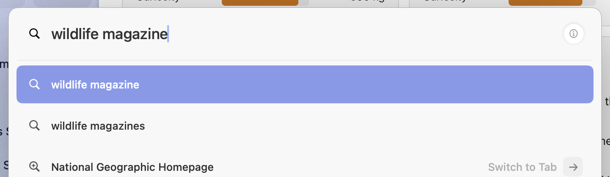
</p>

**Search by meaning, in milliseconds.** Type what a page or a file is about, not its name, and the command bar finds it: the tab, the page you visited, or the document on your Mac. A local embedding model (EmbeddingGemma) answers in about 20 ms, and the index never leaves your Mac.

<picture>
  <source media="(prefers-color-scheme: dark)" srcset="docs/media/readme/divider-dark.svg">
  <source media="(prefers-color-scheme: light)" srcset="docs/media/readme/divider-light.svg">
  
</picture>

## More AI (better than Dia)

<p align="center">
  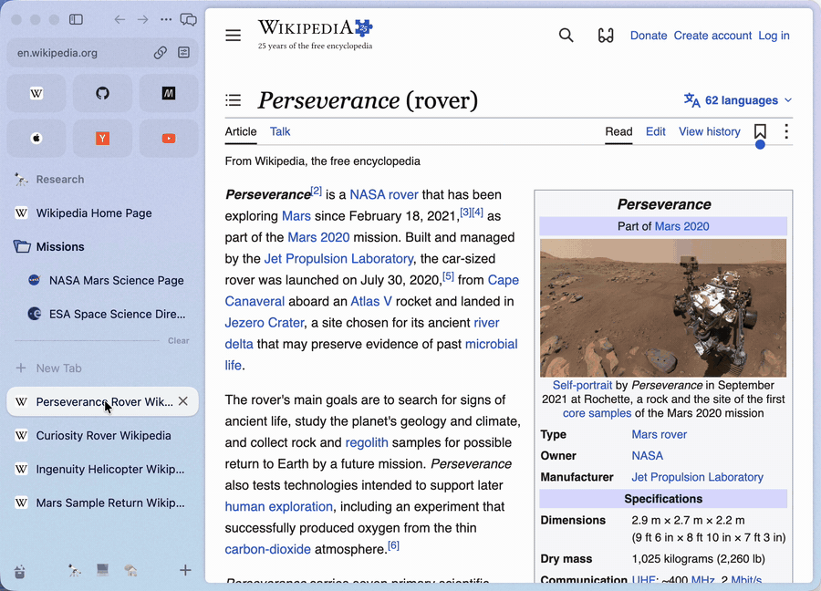
</p>

**An agent that can see your tabs.** Open the AI panel with ⌥⌘A, or drag a tab to the right edge of the window. Drag in more tabs, or type @ and part of a tab's name. The agent reads them, compares them, and can open, close, group, move and split tabs for you.

<p align="center">
  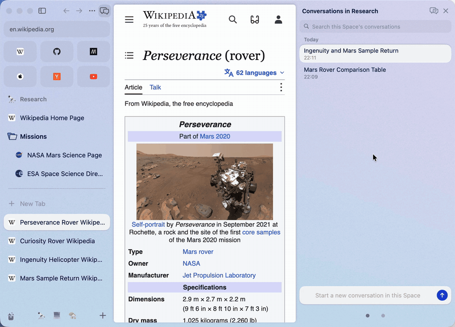
</p>

**Every conversation is kept, per Space.** Come back tomorrow and carry on. Rest the pointer on a conversation and the tabs it used light up in the sidebar.

<p align="center">
  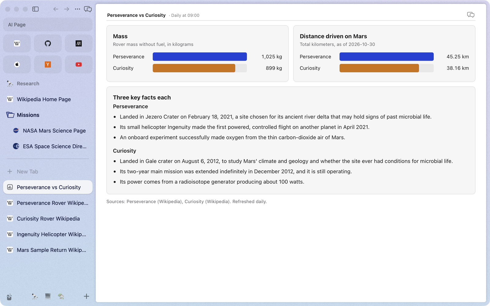
</p>

**Pages that keep themselves up to date.** Ask for a price watch or a weekly reading list. The agent builds a page, you save it as a tab, and it refreshes itself on the schedule you pick. Tick things off and take notes right in it.

<p align="center">
  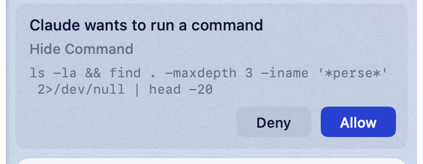
</p>

**You stay in charge.** Page text is checked for hidden instructions before an agent sees it, and once a conversation has read a page, every tool the agent wants to run waits for your OK.

<picture>
  <source media="(prefers-color-scheme: dark)" srcset="docs/media/readme/divider-dark.svg">
  <source media="(prefers-color-scheme: light)" srcset="docs/media/readme/divider-light.svg">
  
</picture>

## Arc, pixel for pixel

<p align="center">
  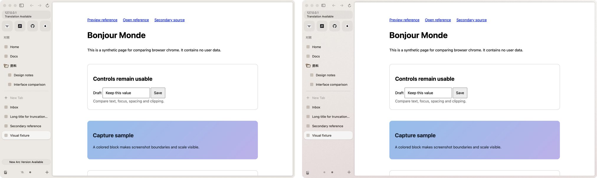
</p>

Arc 1.170 on the left, Brk on the right, same window and same pages: 0.14% of the pixels differ, and the visible one is Arc's update button. Sizes, colours, timings and rules are read from Arc's own app and compared with the real Arc on the same screen. Of the 148 Arc features in the ledger (`docs/completion/features.json`), 124 are verified.

## Not in Brk yet

<details>
<summary><b>The Arc features Brk has not verified yet, and why</b></summary>

These are the 24 Arc features that Brk has not verified, with the reasons recorded in the ledger, followed by two smaller gaps.

**Blocked**

- **Extension buttons and their pop-ups (A097).** CEF 154 has no interface for extensions. Chromium opens an extension's pop-up only from Chrome's own toolbar, and putting the pop-up in a view of Brk's own makes most extensions act on the wrong tab. Brk shows the extension buttons greyed out. Pop-ups do work on Brk's own Chromium build (`engine/`), but that build is not the default, because 19 of 38 sampled scenarios fail on it.
- **Pixel identity on every screen (A148).** The screens that need a signed-in Arc have no reference pictures yet, so the screen-by-screen comparison is not complete.

**Left out on purpose**

- **Account, sign-in, membership and referrals (A123, A124).** Brk has no account.
- **Send to Dia (A126).** It sends a tab to The Browser Company's other browser.
- **Notes (A100).** Arc 1.170 has no menu or command bar entry for making a note. Arc is retiring them.
- **Menu bar icon (A132).** Arc 1.170 has none either. There is no setting for it and no code that creates one.
- **Ask on Page (A135).** Arc 1.170's desktop app has no entry for it. ⌘F only finds text, and neither the Tabs menu nor the Max settings list it. In Brk, the AI panel can read the page instead.

**Deferred**

- **Software updates and the update banner (A127, A128).** The user deferred these. Brk does not update itself. To get a newer version, build it from source.

**Partly done**

- **Default browser and links from other apps (A112).** Links sent from other apps open and are routed by Air Traffic Control, which was tested with a registered copy of the app. In Settings, though, the default-browser status is read only once, when Settings opens, and a failure to become the default is not reported.
- **Dock tile (A131).** The Dock icon shows download progress, and its menu has New Window and New Incognito Window. The download count badge is set but does not show without notification permission. The Dock plug-in that shows your chosen icon while Brk is closed is built, but its last step, with Brk kept in the Dock, has not been checked.
- **AppleScript (A133).** The scripting dictionary follows Arc's. It covers windows, tabs and Spaces, with the commands make, count, close, select, go back, go forward, reload, stop, execute and focus, and it was tested inside Brk's own process. Running it from `osascript` needs a one-time approval in System Settings, which has not been done.

**Built, not yet verified**

- **Favorite badges (A014).** The GitHub unread dot and the time to the next meeting have no Arc picture to compare against, since that needs GitHub and a calendar signed in to Arc. There is also a known bug. Cancelling Connect GitHub Notifications clears a badge that was working.
- **Tab groups (A035).** There is no Arc picture of a group header to compare against, because Arc's Tidy could not be triggered on the test Mac.
- **Save, print, share and cast (A044).** Casting has not been tried with a real receiver, since there is none near the test Mac. Sending a job to a printer and the Share menu have not been checked with real input.
- **Auto-archive banner (A082).** It is rebuilt from Arc's binary. Arc shows it only on a new account, so there is no Arc picture to compare against.
- **Easels (A101).** Drawing, text, moving, deleting and PNG export work. Resizing with the corner handles, undo and colour choice are missing.
- **Library Media page (A103).** It lists Brk's own captures. There is no Arc picture of the page with content, because Arc lists the screenshot folder only after a permission prompt.
- **Picture in picture (A104).** Picture in picture for Google Meet needs a signed-in Meet call and has not been checked.
- **Site permissions (A108).** Camera, microphone, location and notifications have not been checked through macOS's own permission prompts, since that would change system settings.
- **Per-site rules (A110).** The keep-alive, picture-in-picture and suspension rules work, but the "page is using the camera or microphone" case needs macOS permission and has not been checked.
- **Onboarding (A119).** Everything passes except the optional "make Brk the default browser" step, which tests leave off.
- **Import from other browsers (A122).** Importing bookmarks and history works. Importing passwords needs a real Keychain and Touch ID or password prompt, which tests cannot answer.

**Smaller known gaps**

- **Little Arc's download pill.** Being built now.
- **macOS screenshots in the Library list.** Listing them needs permission for the Desktop folder, so the list shows only Brk's own captures.

</details>

<details>
<summary><b>Build from source</b></summary>

Needs macOS on Apple silicon and Xcode with Swift 6. The first build downloads CEF (132 MB).
Ready-built apps for Apple silicon and Intel, from every merge into main, are on the [Releases page](https://github.com/cyang2020/brk/releases); see [docs/release.md](docs/release.md).

```sh
scripts/build.sh                 # release build, unit tests, CEF bundle and signature: dist/Brk.app
SKIP_TESTS=1 scripts/build.sh    # the same without the unit tests
open dist/Brk.app
```

Tests:

```sh
swift test                                            # unit tests
swift build -c release --product brk-e2e
python3 scripts/run-native.py <name> --set smoke      # native scenarios with real input on a real launch
```

Which tests a change adds, and what runs before a merge, is in `docs/testing-policy.md`.

- `Sources/`: the SwiftPM targets. `Brk` is the app; `BrkDomain` holds the state and its rules; `BrkSidebar`, `BrkContent`, `BrkOverlays`, `BrkLibrary` and `BrkSettings` are the UI; `BrkCEF` is the CEF engine.
- `engine/`: Brk's own Chromium build, experimental. CEF is the shipped engine.
- `docs/`: the design (`docs/design/`), Arc facts (`docs/arc-anatomy/`), the feature ledger and the testing rules.

The first version (October 2026) was an Electron app, kept at the tag `electron-v1`.

</details>

---

<p align="center"><sub>MIT licensed. Brk is an independent project and is not affiliated with The Browser Company. Arc is a trademark of The Browser Company.</sub></p>
