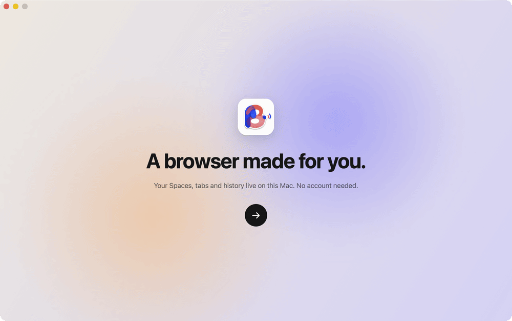
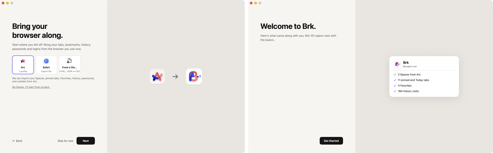

<picture>
  <source media="(prefers-color-scheme: dark)" srcset="docs/media/readme/banner-dark.svg">
  <source media="(prefers-color-scheme: light)" srcset="docs/media/readme/banner-light.svg">
  
</picture>

<p align="center">
  <a href="https://github.com/cyang2020/brk/releases/download/latest/Brk-arm64.dmg"></a>
  <a href="https://github.com/cyang2020/brk/releases/download/latest/Brk-x86_64.dmg"></a>
  <a href="https://cyang2020.github.io/brk/"></a>
  <a href="https://discord.gg/4d6ShsjCYz"></a>
</p>

<p align="center">
  <b><a href="#download">Download</a></b> ·
  <a href="https://github.com/cyang2020/brk/releases">All releases</a> ·
  <a href="https://cyang2020.github.io/brk/">Website</a> ·
  <a href="https://github.com/cyang2020/brk/issues/new/choose">Report a bug</a> ·
  <a href="https://github.com/cyang2020/brk/discussions">Discussions</a> ·
  <a href="CONTRIBUTING.md">Contributing</a>
</p>

<p align="center">
  
  
  
  
  <a href="LICENSE"></a>
</p>

<p align="center">
  <a href="#join-the-brk-discord">Community</a> ·
  <a href="#t-upgraded">⌘T, upgraded</a> ·
  <a href="#everyday-upgrades">Everyday upgrades</a> ·
  <a href="#ai-on-your-mac">AI on your Mac</a> ·
  <a href="#more-ai-better-than-dia">More AI</a> ·
  <a href="#arc-pixel-for-pixel">Arc, pixel for pixel</a> ·
  <a href="#move-in-from-arc-chrome-or-safari">Move in</a> ·
  <a href="#download">Download</a> ·
  <a href="#bug-reports-and-fixes">Bug reports and fixes</a> ·
  <a href="#not-in-brk-yet">Not yet</a>
</p>

<picture>
  <source media="(prefers-color-scheme: dark)" srcset="docs/media/readme/features-dark.svg">
  <source media="(prefers-color-scheme: light)" srcset="docs/media/readme/features-light.svg">
  
</picture>

<p align="center">
  
</p>

Everything you know from Arc is here: the sidebar, Spaces, Favorites, Pinned tabs, split view, Little Arc, Peek, Boosts, the Library, the command bar and the shortcuts. Brk rebuilds Arc 1.170 feature by feature, from Arc's own measurements. On top of that it adds the things Arc never had.

<picture>
  <source media="(prefers-color-scheme: dark)" srcset="docs/media/readme/divider-dark.svg">
  <source media="(prefers-color-scheme: light)" srcset="docs/media/readme/divider-light.svg">
  
</picture>

## Join the Brk Discord

<p align="center"><b>Let's maintain <s>Arc</s> Brk together.</b></p>

<p align="center">
  <a href="https://discord.gg/4d6ShsjCYz"></a>
</p>

Arc no longer gets new features, and many people still use it every day. Brk is built so they can keep the browser they know. Everyone is welcome in the [Brk Discord](https://discord.gg/4d6ShsjCYz). Ask questions, share your setup and workflows, tell us where Brk still differs from Arc, discuss ideas, or help test fixes before they ship. Confirmed bugs and development work are tracked on GitHub, and longer threads can go to [Discussions](https://github.com/cyang2020/brk/discussions). To contribute code, see [`CONTRIBUTING.md`](CONTRIBUTING.md). Brk is MIT licensed.

<picture>
  <source media="(prefers-color-scheme: dark)" srcset="docs/media/readme/divider-dark.svg">
  <source media="(prefers-color-scheme: light)" srcset="docs/media/readme/divider-light.svg">
  
</picture>

## ⌘T, upgraded

<p align="center">
  
</p>

Inspired by Raycast, the command bar does much more than open pages. Type, and the answer is already there. Type a word and press **Tab** to switch the bar into a mode.

| Type | You get |
| --- | --- |
| `2^10 * 3`, `15% of 240` | The answer in the bar. Return copies it. |
| `100 usd in eur`, `5 km in miles`, `time in tokyo` | Currency, unit and time-zone conversions. |
| `file` + Tab, then a name or what the file is about | Files on your Mac, by name or by meaning, from a local index: a query takes about 20 ms. Return opens, ⌘Return reveals in Finder, ⌥Return copies the path. |
| `app` + Tab, or just the app's name | Open any app. |
| `emoji` + Tab | Find an emoji and copy it. |
| `translate` + Tab | Translate text, or the whole page. |
| `define` + Tab | The macOS dictionary. |
| `color` + Tab, or `#ff5500` | A colour in hex, RGB and HSL. |
| `window` + Tab, or `left half` | Put the window on a half, centre it, maximise it or move it to the next display. |
| `split` + Tab | Open a tab or a page beside the current one. |
| `claude`, `codex`, `gemini`, `cursor` + Tab | Ask that agent, with the current tab attached. `gpt` also opens Codex. |
| `page`, `summarize` + Tab | Ask about the page you are on, or summarise it. |
| A site's name + Tab | Search inside that site. |
| A command, such as `dark mode` or `new space` | Run it. Every menu command is reachable by name. |
| Words from an old AI conversation | Find the conversation and continue it. |

Most modes also answer to Chinese words: 问, 翻译, 查, 分屏, 窗口, 文件, 应用, 表情, 算, 颜色.

The ordinary results (open tabs, history, suggestions, top sites) are ranked by a port of Arc's own scoring, so the first row is the one Arc would pick. It learns from you: pages you type often and commands you run rise to the top.

<picture>
  <source media="(prefers-color-scheme: dark)" srcset="docs/media/readme/divider-dark.svg">
  <source media="(prefers-color-scheme: light)" srcset="docs/media/readme/divider-light.svg">
  
</picture>

## Everyday upgrades

<p align="center">
  
</p>

**Downloads where you look.** A new download flies from your click into the Library button. Rest the pointer on the button to see your four newest downloads and captures, with progress, preview and drag-out.

<p align="center">
  
</p>

**Your mouse works everywhere.** Back and forward buttons and mouse-driver swipes go back and forward over a page and switch Spaces over the sidebar. ⇧⌘] and ⇧⌘[ step through tabs, and a middle-click on a tab closes it.

<picture>
  <source media="(prefers-color-scheme: dark)" srcset="docs/media/readme/divider-dark.svg">
  <source media="(prefers-color-scheme: light)" srcset="docs/media/readme/divider-light.svg">
  
</picture>

## AI on your Mac

<p align="center">
  
</p>

**No new subscription.** Brk runs the coding agent signed in on your Mac (Claude, Codex, Gemini, Cursor or OpenCode) on the plan you already pay for. There is no Brk account. To use your own Anthropic or OpenAI API key instead, add it under Settings → Max → Accounts. That service then bills you per token.

**The small jobs never leave your Mac.** Naming tabs and groups, tidying Today into groups and spotting duplicate tabs can run on small models on your Mac (Settings → Max → On This Mac). They don't call a large model, cost nothing and keep working offline.

<p align="center">
  
</p>

**Search by meaning, in milliseconds.** Type what a page or a file is about, not its name, and the command bar finds it: the tab, the page you visited, or the document on your Mac. A local embedding model (EmbeddingGemma) answers in about 20 ms, and the index never leaves your Mac.

<picture>
  <source media="(prefers-color-scheme: dark)" srcset="docs/media/readme/divider-dark.svg">
  <source media="(prefers-color-scheme: light)" srcset="docs/media/readme/divider-light.svg">
  
</picture>

## More AI (better than Dia)

<p align="center">
  
</p>

**An agent that can see your tabs.** Open the AI panel with ⌥⌘A, or drag a tab to the right edge of the window. Drag in more tabs, or type @ and part of a tab's name. The agent reads them, compares them, and can open, close, group, move and split tabs for you.

<p align="center">
  
</p>

**Every conversation is kept, per Space.** Come back tomorrow and carry on. Rest the pointer on a conversation and the tabs it used light up in the sidebar.

<p align="center">
  
</p>

**Pages that keep themselves up to date.** Ask for a price watch or a weekly reading list. The agent builds a page, you save it as a tab, and it refreshes itself on the schedule you pick. Tick things off and take notes right in it.

<p align="center">
  
</p>

**You stay in charge.** Page text is checked for hidden instructions before an agent sees it, and once a conversation has read a page, every tool the agent wants to run waits for your OK.

<picture>
  <source media="(prefers-color-scheme: dark)" srcset="docs/media/readme/divider-dark.svg">
  <source media="(prefers-color-scheme: light)" srcset="docs/media/readme/divider-light.svg">
  
</picture>

## Arc, pixel for pixel

<p align="center">
  
</p>

Arc 1.170 on the left, Brk on the right, same window and same pages: 0.14% of the pixels differ, and the visible one is Arc's update button. Sizes, colours, timings and rules are read from Arc's own app and compared with the real Arc on the same screen. Of the 148 Arc features in the ledger (`docs/completion/features.json`), 126 are verified.

<picture>
  <source media="(prefers-color-scheme: dark)" srcset="docs/media/readme/divider-dark.svg">
  <source media="(prefers-color-scheme: light)" srcset="docs/media/readme/divider-light.svg">
  
</picture>

## Move in from Arc, Chrome or Safari

<p align="center">
  
</p>

The first time you open Brk, a full-window setup walks you through it in Arc's order: a welcome, what to call you (kept on your Mac, there is no account), which browser to bring along, your bookmarks, Favorites, a theme, the ad blocker, Max and the default browser. It ends on a summary of what came over, then opens Brk 101. Most steps can be skipped.

<p align="center">
  
</p>

**Brk reads the other browser directly**, with no export step for most of them:

| From | What comes over |
| --- | --- |
| **Arc** | Spaces, pinned tabs, Today, folders, split views and Favorites, one to one, plus history, passwords and site logins |
| **Chrome, Brave, Edge, Vivaldi, Opera, Opera GX** | Bookmarks (into Pinned, in a folder "Imported from Chrome" and so on), history, passwords and site logins, profile by profile |
| **Safari** | Export your browsing data from Safari (File › Export Browsing Data) and drop the ZIP in: bookmarks, history and passwords. Safari 17 and older go through Full Disk Access instead |
| **Firefox** | Bookmarks and history (quit Firefox first) |
| **A file** | An exported HTML, JSON or CSV file |

History covers the last 90 days. Passwords and site logins are encrypted by the other browser, so macOS asks for your Mac's password once per profile; Brk explains this before the prompt appears and you can switch them off. Passwords go into Brk's own Chromium password store, so login forms fill in by themselves; passwords imported while Brk is running start filling in after a restart. Brk copies the other browser's files before reading them, so Arc, Chrome and Safari can stay open, and nothing in them is changed. To import again later, choose **Brk › Import from Another Browser…**; a second import adds only what is new.

<picture>
  <source media="(prefers-color-scheme: dark)" srcset="docs/media/readme/divider-dark.svg">
  <source media="(prefers-color-scheme: light)" srcset="docs/media/readme/divider-light.svg">
  
</picture>

## Download

Download the disk image for your Mac:

| Your Mac | Download |
| --- | --- |
| Apple silicon (M1 and later) | **[Brk-arm64.dmg](https://github.com/cyang2020/brk/releases/download/latest/Brk-arm64.dmg)** |
| Intel | **[Brk-x86_64.dmg](https://github.com/cyang2020/brk/releases/download/latest/Brk-x86_64.dmg)** |

Open it and drag **Brk** into Applications. Builds are signed with a Developer ID and notarized by Apple, so they open with a double-click. Needs macOS 14 Sonoma or later. The links always fetch the newest version. Older versions and their notes are on the [Releases page](https://github.com/cyang2020/brk/releases). How the pipeline works is in [`docs/release.md`](docs/release.md).

### Updates

Brk checks for signed updates and shows a button above the sidebar's Spaces dock when one is available. Click it to download the update in the app, then restart into the new version. Tabs and settings stay in place. You can also choose **Brk › Check for Updates…**.

Copies that show version 0.1.0 were installed before 0.0.1 and have no updater. Install the [latest release](https://github.com/cyang2020/brk/releases/latest) from its disk image once. Later versions update in the app.

## Bug reports and fixes

Report a bug, or a place where Brk behaves differently from Arc, in one of these ways:

- **From inside Brk.** Help › **Report a Bug…** or **Send Feedback…** opens a GitHub issue with your Brk version, macOS version and Mac type already filled in. Nothing is sent until you submit it. After a crash, Brk offers once to report it on the next launch.
- **On GitHub.** [Open an issue](https://github.com/cyang2020/brk/issues/new/choose) and pick **Bug report**, **Feature request or feedback**, or **Arc parity**. Use **Arc parity** for "Arc does X, Brk does Y", with a screenshot.
- **Security issues.** Report them privately through [GitHub's security advisories](https://github.com/cyang2020/brk/security/advisories/new), as described in [`SECURITY.md`](.github/SECURITY.md).

Each version's release notes list what it fixes, on the [Releases page](https://github.com/cyang2020/brk/releases). The fixes from the builds before versions began are in the [0.0.1 notes](https://github.com/cyang2020/brk/releases/tag/v0.0.1). In Brk, **Help › Release Notes** shows the notes for your version and the ones before it. To get a GitHub notification for each new version, choose **Watch › Custom › Releases** at the top of the [repository page](https://github.com/cyang2020/brk).

## Not in Brk yet

<details>
<summary><b>The Arc features Brk has not verified yet, and why</b></summary>

These are the Arc features that Brk has not fully verified, with the reasons recorded in the ledger.

**Blocked**

- **Pixel identity on every screen (A148).** The screens that need a signed-in Arc have no reference pictures yet, so the screen-by-screen comparison is not complete.

**Left out on purpose**

- **Account, sign-in, membership and referrals (A123, A124).** Brk has no account.
- **Send to Dia (A126).** It sends a tab to The Browser Company's other browser.
- **Notes (A100).** Arc 1.170 has no menu or command bar entry for making a note. Arc is retiring them.
- **Menu bar icon (A132).** Arc 1.170 has none either. There is no setting for it and no code that creates one.
- **Ask on Page (A135).** Arc 1.170's desktop app has no entry for it. ⌘F only finds text, and neither the Tabs menu nor the Max settings list it. In Brk, the AI panel can read the page instead.

**Partly done**

- **Default browser and links from other apps (A112).** Links sent from other apps open and are routed by Air Traffic Control, which was tested with a registered copy of the app. In Settings, though, the default-browser status is read only once, when Settings opens, and a failure to become the default is not reported.
- **Dock tile (A131).** The Dock icon shows download progress, and its menu has New Window and New Incognito Window. The download count badge is set but does not show without notification permission. The Dock plug-in that shows your chosen icon while Brk is closed is built, but its last step, with Brk kept in the Dock, has not been checked.
- **AppleScript (A133).** The scripting dictionary follows Arc's. It covers windows, tabs and Spaces, with the commands make, count, close, select, go back, go forward, reload, stop, execute and focus, and it was tested inside Brk's own process. Running it from `osascript` needs a one-time approval in System Settings, which has not been done.

**Built, not yet verified**

- **Favorite badges (A014).** The GitHub unread dot and the time to the next meeting have no Arc picture to compare against, since that needs GitHub and a calendar signed in to Arc. There is also a known bug. Cancelling Connect GitHub Notifications clears a badge that was working.
- **Tab groups (A035).** There is no Arc picture of a group header to compare against, because Arc's Tidy could not be triggered on the test Mac.
- **Save, print, share and cast (A044).** Casting has not been tried with a real receiver, since there is none near the test Mac. Sending a job to a printer and the Share menu have not been checked with real input.
- **Auto-archive banner (A082).** It is rebuilt from Arc's binary. Arc shows it only on a new account, so there is no Arc picture to compare against.
- **Extension buttons and their pop-ups (A097).** Extensions install from the Chrome Web Store and appear in site controls, with Chromium's own pop-ups. How the pop-ups look in every extension state has not been compared with Arc.
- **Easels (A101).** Drawing, text, moving, deleting and PNG export work. Resizing with the corner handles, undo and colour choice are missing.
- **Library Media page (A103).** It lists Brk's own captures. macOS screenshots are not listed, because that needs permission for the Desktop folder. There is no Arc picture of the page with content, because Arc lists the screenshot folder only after a permission prompt.
- **Picture in picture (A104).** Picture in picture for Google Meet needs a signed-in Meet call and has not been checked.
- **Site permissions (A108).** Camera, microphone, location and notifications have not been checked through macOS's own permission prompts, since that would change system settings.
- **Per-site rules (A110).** The keep-alive, picture-in-picture and suspension rules work, but the "page is using the camera or microphone" case needs macOS permission and has not been checked.
- **Onboarding (A119).** The full-window setup is driven screen by screen with real clicks and typing in a test. The "make Brk the default browser" step is left off in tests, because it changes the Mac's settings.
- **Import from other browsers (A122).** Importing from a real Arc profile was checked: 2 Spaces with their folders and a split view, 11 pinned and Today tabs, 4 Favorites and 184 history visits, and a second import added nothing. Chrome-family import was checked on a made-up Chrome profile, including a cookie that keeps a site logged in and a password that fills in after a restart. Not yet checked with real data: Arc's own passwords and cookies (they need someone to type the Mac's password at the Keychain prompt), Chrome (not installed on the test Mac), a real Safari export and Firefox. Extensions, open tabs and payment cards are not imported yet.

</details>

<details>
<summary><b>Build from source</b></summary>

Needs macOS 14 or later and Xcode with Swift 6. Download the pinned BrkCore framework for your Mac, or build it using `engine/README.md`.
Ready-built apps of every version, for Apple silicon and Intel, are on the [Releases page](https://github.com/cyang2020/brk/releases). How they are built is in [docs/release.md](docs/release.md).

```sh
python3 engine/download-artifact.py "$(uname -m)" --out .build/brkcore
export BRK_CORE_DIR="$PWD/.build/brkcore"
scripts/build.sh                 # release build, unit tests, BrkCore bundle and signature: dist/Brk.app
SKIP_TESTS=1 scripts/build.sh    # the same without the unit tests
open dist/Brk.app
```

Tests:

```sh
swift test                                            # unit tests
swift build -c release --product brk-e2e
python3 scripts/run-native.py <name> --set smoke      # native scenarios with real input on a real launch
```

Which tests a change adds, and what runs before a merge, is in `docs/testing-policy.md`.

- `Sources/`: the SwiftPM targets. Among them, `Brk` and `BrkApp` are the app; `BrkDomain` holds the state and its rules; `BrkSidebar`, `BrkContent`, `BrkOverlays`, `BrkLibrary` and `BrkSettings` are the UI; `BrkCoreEngine` connects the app to Chromium.
- `engine/`: BrkCore, Brk's sole browser engine, with its Chromium patch series and pinned release artifacts.
- `docs/`: the design (`docs/design/`), Arc facts (`docs/arc-anatomy/`), the feature ledger and the testing rules.

The first version (October 2026) was an Electron app, kept at the tag `electron-v1`.

</details>

---

<p align="center"><sub>MIT licensed. Brk is an independent project and is not affiliated with The Browser Company. Arc is a trademark of The Browser Company.</sub></p>
