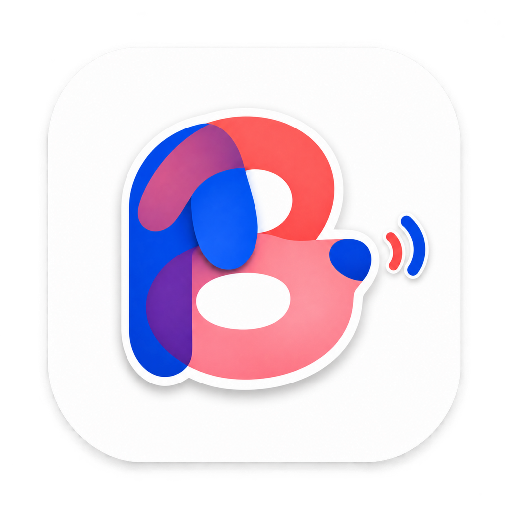
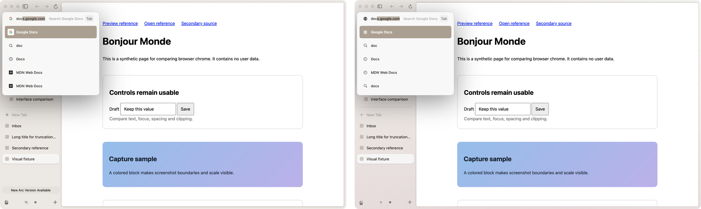

# Brk

**Arc, but better.**

Brk is a native macOS rebuild of the Arc browser, version 1.170. It is written in Swift 6 and AppKit and runs on the Chromium Embedded Framework (CEF 154). It follows Arc feature by feature and pixel by pixel. The sizes, colours, timings and rules come from Arc's own binary, and Brk's screens are compared with the real Arc on the same display.

The feature ledger (`docs/completion/features.json`) lists 148 Arc features. 124 of them are marked verified, and the other 24 are listed under "Not in Brk yet" below with their reasons. On top of the replica, Brk adds 58 features of its own. Most of them are AI features that run on the Claude Code or Codex you already have installed. Brk has no account and no sign-in.

The first version (October 2026) was an Electron app. It is kept at the git tag `electron-v1` and is no longer developed.

## Arc and Brk side by side


Arc 1.170 is on the left and Brk is on the right. Both windows are the same size and show the same test pages. A script compares the two pictures pixel by pixel, and 0.14% of the pixels differ. The clearest visible difference is Arc's "New Arc Version Available" button at the bottom of the sidebar, because Brk has no updater.

## Why it's better

### AI on your own Claude Code or Codex, with no account


Brk runs the coding agent that is already installed on the Mac, either Claude Code or Codex, under the account you are already signed in to. You don't need an API key or an account with Brk. The picture shows Settings → Max with Claude Code 2.1.318 signed in. Haiku 5.5 is set for conversations and for the "basic features". Basic features are small jobs, such as naming tabs, groups and conversations, that go to a small model with a JSON schema. The tab names in the demo pictures below, such as "Perseverance Rover Wikipedia Article", were written that way. If you would rather pay per token, Settings also takes an Anthropic or OpenAI API key and keeps it in the macOS Keychain. The two models under "On This Mac" are covered in "Local models" below.

### Conversations that use your tabs


The AI panel is a column on the right of the window, drawn in the Space's own theme colours. Here Claude (Haiku 5.5) got two Wikipedia tabs and the question shown at the top. Claude read both tabs and answered with a table and links back to the two tabs. The small model named the conversation "Mars Rover Comparison Table".

The agent works on the browser through Brk's own tools. With them it can list, search, read, open, focus, close, move, group and split tabs, and read earlier conversations. Brk saves every conversation. Each Space has its own list of conversations, which you reach with a swipe or the list icon. You can also find a conversation from the command bar or the Library, and continue it on another day. ⌥⌘A, the chat button at the right end of the sidebar's top row, or View › Show AI Conversations opens the panel. You can drag the panel wider, up to half the window.

### Drag tabs in, or type @


While the panel is closed, a tab dragged to the window's right edge shows a dashed drop area, and letting go opens a new conversation with that tab attached. A second tab dragged onto the open panel joins it as a second chip. You can also attach tabs by typing @ and part of a tab's name in the input, or by choosing Ask AI on a tab, folder, selection or Space.

### See which tabs a conversation used


When the pointer rests on a conversation in the list, the tabs that conversation used light up in the sidebar, and the row says "Used 2 tabs". "Used" means tabs you gave it and tabs the agent read, opened or showed. Here the first conversation was about Ingenuity and Mars Sample Return, and the second about Perseverance and Curiosity.

### AI pages that update themselves


The agent can make a page instead of a text answer, and you can keep that page as a tab in the sidebar. Claude made this page from the two rover tabs after one request, "Make a small page comparing these two rovers ... Keep it as a tab that refreshes every day." Claude set the schedule itself, shown as "Daily at 09:00" in the page's top row. The button at the top right of the page goes back to the conversation that made it.

A kept page can refresh every hour, every day or every week, or when you choose Refresh Now from the row's menu. When a refresh changes the data, a dot appears on the sidebar row. Brk saves the ticks and notes you make inside a page, and you can set a page to show in Today only on chosen days. A scheduled refresh can only read your tabs and update the page's data. It cannot run commands or open new addresses. Pages the agent writes run in a WebKit sandbox with no network.

### Safety around agents


Once page text is part of a conversation, every tool outside Brk's own asks first, each time, and the allow rules in your own Claude settings do not apply. Here Claude wanted to run `ls` and `find` in a conversation that had a Wikipedia tab attached. After Deny, it said it had not run the search. Brk's own tools that change your layout ask too. A request to put four tabs side by side came with Deny, Allow in This Conversation and Allow. An address the agent has not visited before also asks before it opens.

Before page text reaches the agent, Brk checks it for instructions written to an AI. Fixed phrase patterns run first. After that, a short page is read by JevK5 on this Mac and a long page by the small model. If a page is flagged, every tool in that conversation asks first, and if the check cannot finish, Brk treats the page as unsafe.

### Cmd+T quick actions


The ⌘T bar answers many queries without opening a page. It does sums, unit conversions, the time in other cities and colours (`#ff5500` also gives its rgb and hsl values). A prefix word followed by Tab switches the bar to that prefix: `emoji`, `define` (the macOS dictionary, offline), `translate` (answered by the agent) and `window` (places Brk's window, for example on the left half). Typing an app's name opens the app. Pressing Tab on ordinary text sends it to the agent ("Ask Claude").

### Local models


Settings → Max offers two optional downloads that run on the Mac in a llama.cpp helper: EmbeddingGemma 2 (310 MB) and JevK5 4B (2.7 GB). What they read never leaves the Mac. EmbeddingGemma 2 finds tabs, history and archived tabs by meaning. In the picture, "wildlife magazine" finds the open National Geographic tab, although the two share no word. JevK5 answers yes/no questions, such as "is this a duplicate?" and the short-page safety check.

With both models downloaded and no agent and no key, Tidy, new-tab placement and duplicate finding still work. Tidy is coarser without a text model, though. In the plan's measurements its groups matched hand-made ones at 0.54 to 0.62, against 0.84 to 0.93 for Haiku, and in one run it put eight developer tabs into a single group, "For Developers".

### Arc details rebuilt recently


**Library button.** When a download starts, its icon flies from the point you clicked into the Library button at the bottom left, on the path and timing measured in Arc. Resting the pointer on the button lists the newest downloads and captures above it, as in Arc. In the picture, a click on Wikipedia's "Download as PDF" button starts the download, and the list then shows four PDFs.


**Mouse side buttons.** With the pointer over the sidebar, the back and forward buttons on the mouse step through the Spaces, as they do in Arc. Over a page, they go back and forward in history.



**Command bar ranking.** Brk ranks the command bar's rows with Arc 1.170's own scoring, using the same 21 signals, weights and boosts, read from Arc's binary. The check typed 39 sets of queries into the real Arc, and Brk's order matches Arc's for most of them. The picture shows where it still differs. For "doc", the first three rows are the same in both. Below them, Arc lists the MDN Favorite twice where Brk lists a visited page and a search, and Arc's first row shows Google's icon where Brk's shows a globe.

## Not in Brk yet

These are the 24 Arc features that Brk has not verified, with the reasons recorded in the ledger, followed by two smaller gaps.

**Blocked**

- **Extension buttons and their pop-ups (A097).** CEF 154 has no interface for extensions. Chromium opens an extension's pop-up only from Chrome's own toolbar, and putting the pop-up in a view of Brk's own makes most extensions act on the wrong tab. Brk shows the extension buttons greyed out. Pop-ups do work on Brk's own Chromium build (`engine/`), but that build is not the default, because 19 of 38 sampled scenarios fail on it.
- **Pixel identity on every screen (A148).** The screens that need a signed-in Arc have no reference pictures yet, so the screen-by-screen comparison is not complete.

**Left out on purpose**

- **Account, sign-in, membership and referrals (A123, A124).** Brk has no account.
- **Send to Dia (A126).** It sends a tab to The Browser Company's other browser.
- **Notes (A100).** Arc 1.170 has no menu or command bar entry for making a note. Arc is retiring them.
- **Menu bar icon (A132).** Arc 1.170 has none either. There is no setting for it and no code that creates one.
- **Ask on Page (A135).** Arc 1.170's desktop app has no entry for it. ⌘F only finds text, and neither the Tabs menu nor the Max settings list it. In Brk, the AI panel can read the page instead.

**Deferred**

- **Software updates and the update banner (A127, A128).** The user deferred these. Brk does not update itself. To get a newer version, build it from source.

**Partly done**

- **Default browser and links from other apps (A112).** Links sent from other apps open and are routed by Air Traffic Control, which was tested with a registered copy of the app. In Settings, though, the default-browser status is read only once, when Settings opens, and a failure to become the default is not reported.
- **Dock tile (A131).** The Dock icon shows download progress, and its menu has New Window and New Incognito Window. The download count badge is set but does not show without notification permission. The Dock plug-in that shows your chosen icon while Brk is closed is built, but its last step, with Brk kept in the Dock, has not been checked.
- **AppleScript (A133).** The scripting dictionary follows Arc's. It covers windows, tabs and Spaces, with the commands make, count, close, select, go back, go forward, reload, stop, execute and focus, and it was tested inside Brk's own process. Running it from `osascript` needs a one-time approval in System Settings, which has not been done.

**Built, not yet verified**

- **Favorite badges (A014).** The GitHub unread dot and the time to the next meeting have no Arc picture to compare against, since that needs GitHub and a calendar signed in to Arc. There is also a known bug. Cancelling Connect GitHub Notifications clears a badge that was working.
- **Tab groups (A035).** There is no Arc picture of a group header to compare against, because Arc's Tidy could not be triggered on the test Mac.
- **Save, print, share and cast (A044).** Casting has not been tried with a real receiver, since there is none near the test Mac. Sending a job to a printer and the Share menu have not been checked with real input.
- **Auto-archive banner (A082).** It is rebuilt from Arc's binary. Arc shows it only on a new account, so there is no Arc picture to compare against.
- **Easels (A101).** Drawing, text, moving, deleting and PNG export work. Resizing with the corner handles, undo and colour choice are missing.
- **Library Media page (A103).** It lists Brk's own captures. There is no Arc picture of the page with content, because Arc lists the screenshot folder only after a permission prompt.
- **Picture in picture (A104).** Picture in picture for Google Meet needs a signed-in Meet call and has not been checked.
- **Site permissions (A108).** Camera, microphone, location and notifications have not been checked through macOS's own permission prompts, since that would change system settings.
- **Per-site rules (A110).** The keep-alive, picture-in-picture and suspension rules work, but the "page is using the camera or microphone" case needs macOS permission and has not been checked.
- **Onboarding (A119).** Everything passes except the optional "make Brk the default browser" step, which tests leave off.
- **Import from other browsers (A122).** Importing bookmarks and history works. Importing passwords needs a real Keychain and Touch ID or password prompt, which tests cannot answer.

**Smaller known gaps**

- **Little Arc's download pill.** Being built now.
- **macOS screenshots in the Library list.** Listing them needs permission for the Desktop folder, so the list shows only Brk's own captures.

## Build and run

Needs macOS on Apple silicon and Xcode with Swift 6. The first build downloads CEF (132 MB).

```sh
scripts/build.sh                 # release build, unit tests, CEF bundle and signature: dist/Brk.app
SKIP_TESTS=1 scripts/build.sh    # the same without the unit tests
open dist/Brk.app
```

## Test

```sh
swift test                                            # unit tests
swift build -c release --product brk-e2e
python3 scripts/run-native.py <name> --set smoke      # native scenarios with real input on a real launch
```

Which tests a change adds, and what runs before a merge, is in `docs/testing-policy.md`. Test evidence (pictures, logs, reports) stays outside the repository.

## Layout

- `Sources/`: the SwiftPM targets. `Brk` is the app. `BrkDomain` holds the state and its rules. `BrkSidebar`, `BrkContent`, `BrkOverlays`, `BrkLibrary` and `BrkSettings` are the UI. `BrkCEF` is the CEF engine, `BrkCoreEngine` runs Brk's own Chromium build, and `BrkE2E` drives native scenarios.
- `engine/`: Brk's own Chromium build (BrkCore.framework) and its patch series. CEF stays the default engine.
- `docs/`: the design (`docs/design/`, with the AI plan in `docs/design/ai-native.md`), Arc facts read from the binary (`docs/arc-anatomy/`), the feature ledger (`docs/completion/features.json`), the testing rules (`docs/testing-policy.md`) and the pictures on this page (`docs/media/`).
- `scripts/`: the build, the native scenario runner and the station, which compares Brk's screens with Arc's on the same display.
