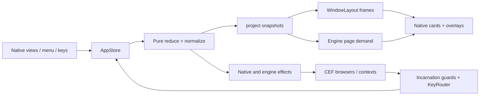

# Brk completion architecture grounding

## Overview

Brk is a native Swift AppKit/SwiftUI browser built from scratch over CEF. Its settled architecture separates pure domain state, display snapshots, geometry, native interaction, and Chromium ownership. The next interfaces must resolve several ownership gaps within that architecture. This report describes immutable commit `6d2d6d50694b17d0c5e4ffcaf5b69bff4a30011d`, checked with `git show`, and reconciles [platform](platform.md), [native-shell](native-shell.md), [integration](integrations.md), and [planning](../plan.md) findings.

The reconciled 148 rows contain 6 verified, 26 implemented, 52 partial, 58 missing, 3 excluded, 2 deferred, and 1 blocked. These are acceptance and evidence states, not coding-effort percentages. The existing baseline has 459 tests with three skips and 45 passing native CEF scenarios. I independently compared all 520 source-manifest entries with this commit and found no mismatches. Those existing runs establish their assertions, not complete feature coverage. No tests or apps were launched for this synthesis.

The product remains Brk, with no cra implementation. Account, membership, referrals, and Send to Dia are excluded. The updater is deferred. AI uses local Claude or Codex CLI tools, and sharing uses local files. Authenticated Arc references still block UI parity. The capture helper is available; fake-auth remains a static candidate because the containment probe failed and no Arc copy was launched.

## Key concepts

- `Doc` owns the shared sidebar tree, spaces, profiles, settings, history, archive, downloads, and window records. Each `WindowDoc.activeBySpace` independently selects an item. Folder collapse and split focus/layout currently live in shared tree payloads. See `Sources/BrkDomain/Model.swift:59` and `:133`.
- `Session` owns loaded-tab demand, live observations, overlays, key-routing memory, and scratch trees. `ContainerScope.window(WindowID)` gives private windows, Little Brk, and Peek their own item ownership. Scratch ownership survives invisibility and never enters the saved tree. See `Model.swift:22` and `:221`.
- `PageID` currently wraps a tab's `ItemID`. `projectPages` emits one global `PageSpec` per loaded tab, with an immutable browsing context for each browser incarnation. `PageLedger.Incarnation` adds a generation so a retiring browser cannot overwrite its replacement. See `Sources/BrkBase/Page.swift:8`, `Sources/BrkDomain/Project.swift:39`, and `Sources/BrkEngine/PageLedger.swift`.
- `WebEngine` owns page creation, actions, views, focus, contexts, and shutdown. Its delegate currently reports by `PageID`, without an origin-window identity. A saved `Download` is a ledger record; it is not a CEF control handle or an independently owned transfer.

## How it works

### Input becomes snapshots, geometry, and effects

Views dispatch typed `Command` values. Menus use `ActionID` and `KeyRouter`; page keys carry a physical chord, delivery stage, and press identity. `AppStore.dispatch` queues reentrant inputs. `dispatchKey` must answer synchronously and passes the key through if dispatch is already active.

`reduce` is the only state writer. Rules update state and append effects, then normalization repairs references and loads visible tabs. `Work.finish` stamps tabs entering or leaving the union of window selections and increments the revision when state changes. `project` derives complete snapshots and page demand. `AppStore.publish` schedules persistent bytes, reconciles pages, and renders windows before executing effects. Effects still run when no state changed. See `Sources/BrkDomain/Reduce.swift:45` and `Sources/BrkApp/AppStore.swift:122`.

`WindowLayout.compute` calculates frames from snapshots and content size. `WindowRootView` and `CardView` apply frames and attach engine views. Temporary drafts and multiselection may remain view-local, but shared commands cannot inspect them without an explicit projection or command payload.

### Logical selection does not establish a native host

The AppKit probe reproduced two windows claiming the same page while only one owns its NSView. Re-selecting the row in the empty window changes no revision, so `AppStore` does not republish. Becoming key only retries focus; it does not reattach the view. On a changing publish, `CardView.host` moves the view, and the last dictionary-iterated claimant gets it. See `Sources/BrkContent/ContentAreaView.swift:129`, `AppStore.swift:176`, and `a3966b7375:verify/completion/native-grounding/probe-output.txt`.

Origin routing is a separate source-proven ambiguity. `AppStore.window(showing:)` chooses the first claiming snapshot for CEF shortcuts and Peek decisions. `Rules/Tabs.openRequested` chooses a sorted claimant for global openers. Neither lookup states which native window actually hosted the event. The probe did not reproduce a wrong-window shortcut. W2-4 uses distinct pages, so it cannot settle this question.

Focus already has the right window boundary. `focus(page, in: window)` keeps weak per-window requests. `CEFEngine.restoreFocus` checks the current browser object, attachment, visibility, input readiness, and absence of a native editor. Preserve those protections. Shared-tab work must define hosting and activation outcomes without letting one window steal another's native focus. It must also preserve scratch-owner routing for hidden private popups and private modifier links, without promoting private content into public Little Brk.

### Reparented views retain CEF ownership

`ChromePage` creates a frameless Chrome-runtime browser with its toolbar hidden. `EmbeddedSurface` borrows `ViewsCompositorSuperview` and `WebContentsViewCocoa`, remembers their original parents, and moves them into a Brk card. The CEF window remains alive, click-through, and never key. Its frame follows the card for native coordinates. See `Sources/BrkCEF/ChromePage.swift:31`, `EmbeddedSurface.swift:45`, and `HostWindows.swift:22`.

Moving a view does not transfer Chromium's internal ownership. `returnViews` must precede browser close. Shutdown restores views, closes browsers, waits for `OnBeforeClose`, allows host destruction, closes auxiliary Chromium widgets, then shuts down CEF. A timeout leaves CEF running and returns failure. New print UI, dialogs, extension popups, DevTools, and PiP need equally explicit ownership and teardown.

### Download observations currently depend on page survival

`BrowserClient.on_before_download` snapshots the borrowed item and calls `ChromePage.decidePolicyForDownload`. `KeyRouter` derives settings from the current page snapshot, falling back to the default profile when absent. Private downloads deliberately use default destination settings. `ChromePage` reserves a collision-free path, optionally runs a modal save panel, and emits `.started` before allowing the transfer.

`on_download_updated` immediately releases the CEF cancel/pause/resume callback. `CefDownload` also merges interrupted and cancelled states. The Library cancel action therefore changes only the saved row; a later completion changes it to finished. Synthetic reducer probes reproduce this behavior. See `Vendor/CefSwift/Sources/CefKit/BrowserClient.swift:301`, `:333`, `CefDownloads.swift:69`, and `Sources/BrkDomain/Rules/Library.swift:26`.

After source closure, `CEFEngine.pageDidEmit` rejects retired objects and `Rules/Tabs.pageEvent` rejects unloaded tabs. `PageLedger.closed` also prevents an old close from removing a replacement. Profile reassignment preserves the logical PageID but replaces its browser, while `downloadEvent` re-derives the tab's new profile and rejects the original row's update. These guards correctly protect page state but cannot represent an operation with a different lifetime.

The decision path has the opposite gap: it calls the delegate directly without the engine's live-incarnation guard. A stale browser or reentrant modal answer can choose settings from a replacement context. This race is inferred from source, not reproduced natively. Raw CEF permits updates before `on_before_download`, so start-first ordering cannot become an invariant. Transfer survival and callback usability after browser destruction remain runtime unknowns.

### Context disposal, data clearing, and permissions differ

Default pages use `Chromium/Default`; custom profiles use `Profile-<id>` and wait for `ProfileLoader` initialization. Incognito pages share one in-memory context until the last private window closes. Private history, archive, and download metadata stay out of persistence even though a requested file may remain. This does not prove absence from logs or all storage classes. `CEFEngine.forget` releases ownership, and custom-profile disposal marks its directory for deletion before the next CEF launch. Default-profile forgetting does nothing. Existing browsers can retain their context.

At this baseline, History clearing emits `forgetBrowsingData`, wrongly combining history removal with profile disposal. The parent repaired this behavior in `ddc2854`. Clear History now removes only visits. The [before/after regression](../../../verify/completion/history-safety/REPORT.md) includes real CEF restart checks and the full 46-scenario run. This repair is outside the report's grounding baseline and does not implement scoped data clearing. Cookie deletion, HTTP cache deletion, and broader site storage need separate scopes, completion barriers, and results. URL-only cookie deletion excludes domain cookies; cache clearing is context-wide in the available API. See `CEFEngine.swift:186`, `CEFProfiles.swift:49`, `Rules/Library.swift:43`, and pinned `cef_cookie_capi.h:103`.

Permission callbacks currently receive an immediate default deny. CefKit discards frame identity, prompt ID, dismissal, and the distinction between desktop and device capture. Callback release occurs inside successful owner lookup, so owner-missing paths also need explicit handling. Future native prompts must preserve origin, raw capability, context, document/incarnation, and window ownership through answer or dismissal. See `BrowserClient.swift:615` and `CefPermission.swift:65`.

### Persistence and later workflows constrain the next interfaces

`StateCodec` alone defines v2 migration and repair. It excludes scratch trees and nonstandard windows, restores selected pages lazily, and converts unfinished downloads to failed. `StateFile` handles bytes through generation-guarded debounce and atomic replacement; quit flushes before engine shutdown. See `Sources/BrkDomain/Codec.swift:69`, `:312`, `:481`, and `Sources/BrkApp/StateFile.swift:49`.

Later Notes, Easels, Boosts, imports, and sync must retain those boundaries. Current CLI AI has only a narrow rename application path; timeout, subprocess cancellation, large output, and private-content permissions need verification. Existing file export serializes links, not offline page contents, and ignores write errors. These gaps remain scheduled after the next batch.

## Where things live

Paths without a repository prefix below are under `Sources/`.

| Concern | Starting files and symbols |
| --- | --- |
| State and contracts | `BrkDomain/{Model,Command,Effect,Snapshot,Project,Codec}.swift`; `BrkBase/Page.swift` |
| Rules and keyboard policy | `BrkDomain/Rules/`; `Actions.swift`; `KeyRouting.swift` |
| Native ownership and rendering | `BrkApp/{AppStore,WindowController,KeyRouter}.swift`; `BrkContent/`; `BrkLayout/` |
| Browser lifetime | `BrkEngine/{WebEngine,PageLedger}.swift`; `BrkCEF/` |
| CEF callback conversion | `Vendor/CefSwift/Sources/CefKit/{BrowserClient,CefBrowser,CefDownloads,CefPermission}.swift` |

## Gotchas and constraints for the design pair

The next designs must compare same-tab hosting and reliable origin routing, real download control across close/reassignment/private expiry, and typed find/save/print/PDF/data-clear requests. Each needs an initiating owner, correlation identity, stale-answer rule, cancellation behavior, terminal result, and native-window lifecycle. Document-sensitive results may become stale on navigation even when the browser incarnation stays live. This report selects no manager, registry, or page-instance strategy.

Find must distinguish initial/next/previous/close and correlate count, ordinal, and final updates with the query and document. Save/print/PDF must report success, cancellation, failure, or unsupported behavior against an explicit destination. Data-clear requests must name context, origin/site or whole-context scope, and data classes, including unsupported classes, then complete before reload. Callback retention, release, and terminal-state rules must remain valid after the initiating window disappears.

CEF is pinned to `154.0.34`, with C API 14800. Header declarations establish availability, not usable product UI. Find has no Brk bar/results adapter and CefKit always sends `findNext = 0`. Raw PDF, print, and Chrome commands do not establish visible, operable dialogs in a hidden-toolbar, never-key host. Command IDs must be resolved through supported bindings rather than guessed numbers.

Before freezing APIs, runtime probes must observe throttled-download bytes and files through cancel, source close, context reassignment, private expiry, and immediate quit. Probe find-result ordering and save/print/PDF window ownership and teardown. Add a real-CEF same-tab two-window scenario. Preserve N1/N2, W2-11/Q/A/P, private-navigation cases, and profile isolation. Find-and-replace, selection commands, cast, extensions, site controls, media, advanced native tools, creative documents, AI, and sync remain in the inventory after this batch.
