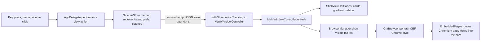

# Reference bases for the Swift rebuild: cra and CefSwift

## Summary

We want a native Swift and AppKit Arc with embedded Chromium (CEF). Two open-source projects could serve as a base: `cra` (a full Arc replacement app) and `CefSwift` (a SwiftPM package that embeds CEF). I cloned both, read them, built them on this Mac, and compared cra against our Arc anatomy docs.

Results in short:

- cra builds here without errors in about 110 seconds and produces a 345 MB ad-hoc signed `Cra.app`. CefSwift builds in 15 seconds, its 80 tests pass (2 are skipped without a CEF framework), and its plugin turns the example apps into 327 MB `.app` bundles. Nothing was launched, because this shell cannot open windows.
- Against the 71 features and modules in section 3 of our anatomy report, cra has 25 present, 22 partial and 24 absent.
- Against Arc's 162 menu commands, cra matches 56 exactly (same label and same key), has 20 more with the same key or label but not both, and lacks 86. Most of the missing ones are standard Edit submenus and Arc-only features.
- Recommendation: option (b). Start a new Swift app that owns our domain design (one state owner, a pure reducer, the ported Electron tests), use CefSwift for CEF download, bundling and loading, and copy cra's bridge patterns (MIT) where CefSwift has gaps. Do not fork cra. The biggest risk is the page hosting mode: no mode is proven yet to give Arc's single window with a rounded page card, native overlays above the page, and Chrome extensions. That can only be settled by a spike (a short throwaway prototype) on a Mac with a display.

## How to read this report

Path prefixes:

- `cra/` is `/Users/administrator/.cache/arc-ref/cra/` at commit `df28d1a`.
- `CefSwift/` is `/Users/administrator/.cache/arc-ref/CefSwift/` at commit `ba6ebff`.
- `anatomy-m` is `docs/arc-anatomy/model-and-shortcuts.md`, `anatomy-v` is `docs/arc-anatomy/visual-and-copy.md`, `rationale` is `docs/design/rationale.md` (all in this repo).
- `logs/` is `/Users/administrator/.cache/arc-ref/` (build logs, the menu comparison output) and `scripts/` is `/Users/administrator/.cache/arc-ref/scripts/`.

Labels:

- **observed**: read in a file or printed by a command I ran.
- **inferred**: my reading of observed code or names. Likely, not proven.
- **needs a running app**: cannot be settled by reading or building; it needs Arc or cra on a Mac with a display.

Environment: SSH login on an Apple-silicon Mac, macOS 26.6.2, Xcode 26.6, Swift 6.3.3, CMake from Homebrew already installed (`swift --version`, `xcodebuild -version`, `sw_vers`; observed).

How the investigation was done: the **how** skill normally splits exploration across subagents. This was one bounded codebase, so I read it myself and checked every file pointer directly. Cloned code was treated as untrusted. I read `scripts/build.sh`, `scripts/fetch-cef.sh`, `scripts/fetch-sparkle.sh` and the CefSwift plugin source before running them. I downloaded cra's CEF archive myself first and checked its SHA-256 against the digest GitHub publishes for that release asset. Nothing that was built was launched.

## 1. The two repositories

| | cra | CefSwift |
|---|---|---|
| URL | https://github.com/VictorKildahl/cra | https://github.com/Rajaniraiyn/CefSwift |
| Commit cloned | `df28d1a0d9117aefe5f22fba64afbef12bb13dd5`, 2026-10-29 21:41 +01:00, "Cra 0.1.20: Peek, Site Search, favorites grid, instant extension popups" | `ba6ebff9e232529289662a84704ade1240563031`, 2026-10-05 20:58 UTC, "Bump CEF to 154.0.34+g14c5a08+chromium-154.0.8037.98 (#20)" |
| History | 44 commits; first on 2026-10-24; 39 by Victor, 5 by one other person; 69,936 lines inserted in total | 30 commits; created 2026-06-14; last human commit 2026-06-15; every later commit is a bot CEF bump |
| Stars, forks, open issues | 71, 5, 2 | 19, 3, 1 |
| License | MIT (`cra/LICENSE`) | `CefSwift/LICENSE` is MIT text plus a note that CEF is BSD 3-Clause. `CefSwift/README.md` says "BSD 3-Clause". GitHub reports `NOASSERTION`. |
| CEF pin | `156.0.14+g4fa4ab5+chromium-156.0.8078.48`, cra's own build with H.264/AAC and 7 patches, release `cef-156.0.14-codecs4` (`cra/scripts/fetch-cef.sh:12,16-17`) | `154.0.34+g14c5a08+chromium-154.0.8037.98`, Spotify's stock build, pinned with SHA-1 (`CefSwift/CEF_VERSION.json`); C API version pinned at 14800 (`CefSwift/Sources/CCef/include/ccef_config.h:12-13`) |
| Size of code | 103 Swift files, 30,501 lines in `Sources/Cra`; 2,631 lines of Objective-C++ in `Sources/CraCEF`; 21-line C++ helper | 5,619 lines in `CefKit`, 2,558 in `CefSwiftUI`, 836 in `CCef` (plus 287 vendored CEF header files), 1,009 in the plugin, 1,168 in tests |

Sources: `git log`, `git rev-list --count HEAD`, `gh api repos/<owner>/<repo>` and `wc -l` (all observed).

Notes:

- The brief said CefSwift is BSD-3. The LICENSE file says MIT and the README says BSD-3. Both are permissive, but the conflict should be cleared up, or both notices kept, before we ship code from it (observed).
- The brief said cra lacks Peek. Commit `df28d1a` adds it (`cra/Sources/Cra/App/AppDelegate.swift:397` `openPeek`, `cra/Sources/Cra/UI/Windows/LittleWindowController.swift:939` `PeekDimPanel`). `cra/README.md` still says "Peek: Not yet" (observed). cra changes faster than its docs.
- CefSwift has an open bot pull request (#21, opened 2026-10-26) to move to CEF 156. Nobody has merged it (`gh pr list`; observed).

## 2. How cra works

### Overview

cra is a single AppKit app. One Swift class, `SidebarStore`, holds spaces, sidebar items, the archive, settings and window state, and writes them to six JSON files. Window controllers observe the store and redraw. Pages are CEF browsers, one per opened tab, driven through a hand-written Objective-C++ bridge called CraCEF. By default every page runs in Chrome runtime style inside its own hidden, frameless CEF window. cra then moves Chromium's page views out of that window and into a rounded "card" view in the main window. The sidebar, dock, favorites grid and toolbar are custom AppKit views. SwiftUI is used only for Settings, onboarding, the space editor and the updater (observed; pointers below).

### Key concepts

- `SidebarItem` with `ItemData` = `tab`, `folder`, `container(ContainerKind)` or `split`. The tree is flat by id: `parentID` plus ordered `children` (`cra/Sources/Cra/Model/SidebarModel.swift:119-192`; observed).
- `ContainerKind` = `favorites(spaceID)`, `pinned(spaceID)`, `today(spaceID)`. Each `Space` owns three root containers, so favorites belong to one space, not to a profile (`SidebarModel.swift:3-6,10-13,268-279`; observed).
- `SpaceTheme` = `colors`, `intensity`, `noise`, `appearance`, `vibrant`, `accent`, turned into a derived `SpacePalette` (`SidebarModel.swift:194-253`, `cra/Sources/Cra/UI/Theme.swift:21-48`; observed).
- `ArchivedItem` = the full item snapshot, `archivedAt`, `reason` (`manual`, `auto`, `clear`, `spaceDeleted`), source space, `wasPinned`, source folder and index (`SidebarModel.swift:313-331`; observed).
- `WindowSession` and `WindowPrefs`: per window the focused space and the selected tab per space; shared sidebar width, expanded folders and collapsed pinned sections (`SidebarModel.swift:484-509`; observed).
- `SidebarStore`: `@MainActor @Observable` class, "the single source of truth" (`cra/Sources/Cra/Services/SidebarStore.swift:4-9`; observed).
- `MainWindowController`, `ShellView`, `PaneCardView`: one browser window, its layered content view and one card per split pane (`cra/Sources/Cra/UI/Windows/MainWindowController.swift`, `cra/Sources/Cra/UI/ShellView.swift`, `cra/Sources/Cra/UI/SplitView/PaneCardView.swift`; observed).
- `BrowserManager` and `TabRuntime`: one live CEF browser per opened tab (`cra/Sources/Cra/Services/BrowserManager.swift:5-31,59-104`; observed).
- `CraBrowser` and `CraCEFRuntime`: the Objective-C surface of the bridge (`cra/Sources/CraCEF/include/CraCEF.h`; observed).
- `KeyAction` and the key binding registry: one table of app commands with default shortcuts and command bar trigger words (`cra/Sources/Cra/App/KeyBindings.swift:80-90,150-246`; observed).

### How it works



This diagram shows one round trip. An input calls a `SidebarStore` method directly; there is no command type in between. The store bumps `revision`. `MainWindowController.observeStore` (`MainWindowController.swift:263-276`) re-runs `refresh()` (`:278-343`). `refresh()` works out which tabs are on screen, rebuilds the cards and asks `BrowserManager.show` (`BrowserManager.swift:180-218`) to create or show their browsers. In the default Chrome hosting mode, `embedPage` (`MainWindowController.swift:741`) then moves each page's views into its card (observed).

#### Data model

- Spaces, items and containers follow Arc's `StorableSidebar.json` shape, with one deliberate change: favorites are per space, not shared per profile. The code comment says so (`SidebarModel.swift:3-6`). Older shared favorites are copied into each space on load (`SidebarStore.swift:117-142`). The commit "Per-space favorites" (`a0572f5`) made this change (observed).
- Moving a tab into Pinned or Favorites makes its current URL the saved "home" (`SidebarStore.swift:595-601`). A folder dropped into Today is unpacked into its tabs (`SidebarStore.swift:573-586`). A split is an item whose children are the pane tabs, with width factors keyed by pane id (`SidebarModel.swift:88-105`). This matches Arc's model in anatomy-m 1.6 and 1.7 and our rationale (observed).
- Archiving removes the item from the tree and inserts a snapshot at the front of `archive`, capped at 2,000 (`SidebarStore.swift:1155-1183`). Auto-archive archives Today tabs that no window shows and that have been idle longer than the threshold (`SidebarStore.swift:1257-1267`). It runs at launch and every 30 minutes (`cra/Sources/Cra/App/AppDelegate.swift:67-70`; observed).

#### State ownership and persistence

- One object owns the state, but it is a mutable class with 105 non-private methods. I counted 131 call sites of its mutating methods in 14 files outside the store; `MainWindowController.swift` has 41 and `AppDelegate.swift` 21 (`grep -rcE` over `Sources/Cra`; observed).
- Some domain rules live in UI code, not in the store. Close-and-keep for pinned tabs is in `MainWindowController.closeTab` (`MainWindowController.swift:1214-1233`). The four-pane split limit is in `MainWindowController.swift:389` (observed).
- Time is read with `Date()` directly. There are 16 lines with `Date()` in `SidebarStore.swift`, and there is no injected clock (observed). Tests therefore cannot move time forward the way our Electron reducer tests do (inferred).
- Persistence: `JSONStore<T>` writes one pretty-printed JSON file per store on a background queue, with a 0.4 s debounce, an atomic write, and a `.bak` copy of the previous version. A file that fails to decode is renamed to `.corrupt` and the app starts fresh (`cra/Sources/Cra/Services/Persistence.swift:45-101`). The files are `sidebar.json`, `archive.json`, `windows.json`, `settings.json`, `history.json`, `commandbar.json` (`SidebarStore.swift:45-50`) and `keybindings.json`, all in `~/Library/Application Support/Cra` or `CRA_DATA_DIR` (`Persistence.swift:23-34`). Each file is written on its own, so the set is not saved atomically. New fields are read with `decodeIfPresent` and defaults (`SidebarModel.swift:528-635`) instead of a numbered migration step (observed).

#### How the sidebar is drawn

- The whole sidebar column is AppKit: `SidebarView` holds the top bar, the space pager, the downloads tray, the update banner and the dock (`cra/Sources/Cra/UI/Sidebar/List/SidebarView.swift:3-41`). `SpaceListView` draws the Pinned and Today lists as plain layer-backed row views. It rebuilds a flat list of row models from the store and gives each row a new model only when it changed. It uses one tracking area for hover (`cra/Sources/Cra/UI/Sidebar/List/SpaceListView.swift:9-33`). Favorites are `FavoritesGridView` and `FavoriteTileView` (`cra/Sources/Cra/UI/Sidebar/List/SpaceColumnView.swift:212,419`). The dock is `SpaceDockView` (`SidebarView.swift:503`) (observed).
- `docs/development.md` still says SwiftUI draws the favorites, header, top bar and dock. The code no longer does. `SidebarRootView.swift` and `SidebarItemView.swift` have no references from other files (`grep`; observed).
- Space paging moves layers, and `PagedGradientView` mixes the gradients of the two neighbouring spaces during a swipe (`cra/Sources/Cra/UI/Theme.swift:348-470`; observed).

#### Content area and CEF views

- There is one `CraBrowser` per opened tab, created the first time the tab is shown (`BrowserManager.ensureRuntime`, `BrowserManager.swift:90-104`). Tabs never opened since launch have no browser. Closing a pinned tab or putting a tab to sleep closes its browser (`BrowserManager.swift:274-291`; observed).
- The content area is one rounded `PaneCardView` per visible pane, with the toolbar strip on top and a `webArea` for the page (`PaneCardView.swift:1-40`, `ShellView.swift:4-8`). Metrics come from `CraMetrics`: content inset 10 pt, corner radius 6 pt, sidebar 328 pt by default (220 to 520) (`Theme.swift:475-494`; observed).
- Two hosting modes exist. In Alloy mode the browser's `containerView` is an ordinary `NSView` moved into the pane's host (`BrowserManager.swift:192-199`). In Chrome mode (the default, `AppSettings.chromeEngine = true`, `SidebarModel.swift:428`) each page is a `CefBrowserView` in its own frameless top-level CEF window (`cra/Sources/CraCEF/CraCEF.mm:1527-1541`). `EmbeddedPages` then moves Chromium's private `ViewsCompositorSuperview` and `WebContentsViewCocoa` views from that window into the card. The emptied window stays click-through, and the class's `canBecomeKeyWindow` and `canBecomeMainWindow` methods are replaced at runtime (`cra/Sources/Cra/UI/Windows/EmbeddedPages.swift:4-15,49-85`; observed).
- Switching tabs or spaces does not reload pages. `refresh()` computes the visible panes and calls `BrowserManager.show`, which hides the other browsers and shows the new ones (`MainWindowController.swift:304-327`, `BrowserManager.swift:180-218`). A page is on screen in one window at a time; other windows that show the same tab get a blurred snapshot (`MainWindowController.swift:312-321`; observed).
- Splits use the same path, with several pane ids and width factors (`MainWindowController.swift:305-311`). Peek and Little Windows both use their own window controller, `LittleWindowController` (`LittleWindowController.swift:331-339`; observed).

#### The CEF bridge

- CraCEF is Objective-C++ over CEF's C++ wrapper (`libcef_dll_wrapper`, built with CMake by `fetch-cef.sh`), compiled with CEF's own flags (`cra/Package.swift:5-23,32-43`). Swift sees only `CraCEF.h` (observed).
- One `CraClient` class implements the life span, load, display, request, context menu, keyboard, download, focus, permission and find handlers (`CraCEF.mm:853-870`). Extra pieces: per-profile request contexts, an incognito context, a content blocker, popups, docked DevTools, a browser-level DevTools protocol pipe, and URL fetches with a profile's cookies (`CraCEF.h:175-252`; observed).
- Runtime: Chrome style for pages by default (`CraCEF.mm:1533-1541`), Alloy for the DevTools frontend (`CraCEF.mm:1653-1658`). CEF owns the run loop (`CefRunMessageLoop`, `CraCEF.mm:2038`, called from `cra/Sources/Cra/App/main.swift:63`). The sandbox is on (`settings.no_sandbox = false`, `CraCEF.mm:2004`; observed).

#### Keyboard routing

- A fixed set of "reserved" actions (new tab, close tab, ⌘L, sidebar toggle, next and previous tab and space, split, ⌘1 to ⌘9, ⌃1 to ⌃9, and others) is taken before the page sees the key, in CEF's `OnPreKeyEvent`. Every other shortcut goes to the page first and runs only if the page leaves it alone (`OnKeyEvent`) (`AppDelegate.swift:29-35,663-686`, `CraCEF.mm:1240-1256,2157-2163`; observed).
- When no page has focus, menu key equivalents handle the keys. A local key monitor falls back to physical key codes on non-US layouts (`AppDelegate.swift:640-660`, `KeyBindings.swift:26-44`; observed).
- Users can remap shortcuts, and overrides are saved in `keybindings.json` (`KeyBindings.swift`, `cra/Sources/Cra/UI/Settings/ShortcutsPane.swift`). The menu bar is built in code from the action table (`AppDelegate.swift:861-971`; observed).

#### Window background and theme

- The background is a `CAGradientLayer` with 5 samples from the space colors, top to bottom (`Theme.swift:353-470`). The grain is a 96 x 96 px random noise image generated at launch, tiled at 9 to 10 percent opacity, with multiply blending on light themes and screen on dark ones (`Theme.swift:180-209,292-306`). "Vibrant" themes see the desktop through an `NSVisualEffectView`. Light vibrant themes instead use the private `CABackdropLayer` and `CAFilter` classes, looked up by name at runtime (`ShellView.swift:9-20,108,164`; observed).
- Sidebar fills and text colors are computed from the theme in `SpacePalette`, with constants the author fitted against live Arc screenshots (`Theme.swift:130-166`; the fitting notes are in `cra/docs/arc-reverse-engineering.md:136-189,702-742`; observed).

#### Helper processes and signing

- `CraHelper` is a 21-line C++ main that enters the sandbox, loads the framework and calls `CefExecuteProcess` (`cra/Sources/CraHelper/main.cc`). `build.sh` copies it into five helper apps: plain, Alerts, GPU, Plugin, Renderer (`cra/scripts/build.sh:54-64`; observed).
- Signing goes inside out, ad hoc by default. With `CRA_SIGN_IDENTITY` it uses Developer ID with hardened runtime and the JIT, unsigned-memory, library-validation and dyld-environment exceptions (`build.sh:76-125`, `cra/resources/Cra.entitlements`, `cra/resources/CraHelper.entitlements`). Releases are notarized and shipped through Sparkle by GitHub Actions (`cra/.github/workflows/release.yml`; observed).

#### Tests

- There is no SwiftPM test target (`cra/Package.swift`). Three shell scripts compile single source files with `swiftc` and run hand-written checks: browser manager lifecycle against a fake bridge (42 checks), extension popup ownership (14 checks) and the floating sidebar (28 checks). All three passed here (`cra/Tests/test-browser-manager.sh`, `cra/scripts/test-extension-popup-candidate.sh`, `cra/scripts/test-floating-sidebar.sh`; observed).
- Nothing tests `SidebarStore`, the archive, auto-archive, the command bar ranking or persistence (inferred from the test file list). CI only builds and signs: "CI only checks that Cra builds and signs" (`cra/CONTRIBUTING.md:36`, `cra/.github/workflows/ci.yml`; observed).

### Where things live

| Path | Files, lines | What it is |
|---|---|---|
| `cra/Sources/Cra/App` | 4, 1,453 | `main.swift` startup order, `AppDelegate` (menus, `perform`, timers, URL schemes), `KeyBindings` |
| `cra/Sources/Cra/Model` | 3, 811 | `SidebarModel.swift` (all saved types), `LinkRouting.swift` (Air Traffic Control), `LiveFolderModel.swift` |
| `cra/Sources/Cra/Services` | 29, 7,216 | `SidebarStore` (1,411), `BrowserManager` (639), `SuggestionEngine` (546), `Persistence`, importers, extensions, updater, safe storage, live folders |
| `cra/Sources/Cra/UI` | 67, 21,021 | `Windows/MainWindowController.swift` (2,178), `ShellView`, `Sidebar/List/*` (AppKit sidebar, 4,497), `CommandBar/*`, `SplitView/*`, `Theme.swift`, Settings, onboarding, PiP, Library, Site Control Center |
| `cra/Sources/CraCEF` | 3, 2,631 | Objective-C++ bridge (`CraCEF.mm` 2,214, `CraCEF.h` 259, `CraContentBlocker.h` 158) |
| `cra/Sources/CraHelper`, `cra/Sources/CraDockTile` | 1 each | helper process main; Dock tile plug-in |
| `cra/scripts` | 21 files plus `cef-patches/` | build, fetch, release, CEF source build (`build-cef.sh`), 7 Chromium patches (265 lines) |
| `cra/docs/arc-reverse-engineering.md` | 1,603 lines | the author's static and live notes on Arc 1.168 and 1.170 and Dia 1.54, with measured metrics |

(`find Sources -type f | xargs wc -l`; observed)

### Gotchas

- **Private Chromium internals.** cra finds Chromium's views by class name and replaces methods at runtime in `EmbeddedPages.swift`, `ChromiumWindowCorners.swift`, `ChromiumChildHover.swift` (on `RenderWidgetHostViewCocoa`) and `ChromiumChildFullscreen.swift` (`grep method_setImplementation`; observed). Any CEF upgrade can break these silently (inferred).
- **Custom engine.** The default CEF is the author's own build, downloaded from a cra GitHub release without a checksum check in `fetch-cef.sh` (`fetch-cef.sh:17,30`; observed). Pointing `CEF_URL` at Spotify's stock build fails: the script exits when the framework still contains the string "Chromium Safe Storage", unless the SHA-256 matches one old patched build (`fetch-cef.sh:56-67`). I confirmed that the stock CEF 154 framework contains that string and cra's build does not (`grep -ac`; observed). Rebuilding cra's engine needs about 80 GB and "several hours on an M2 Max" (`cra/scripts/build-cef.sh:11-12`; observed claim).
- **The bridge code itself is stock-compatible.** Diffing cra's CEF 156 distribution against Spotify's stock 156 (SHA-1 `7359a9d2...` checked against the CDN's `.sha1` file) shows `libcef_dll/` and `cmake/` identical and only 4 header files different, all in comments (`diff -rq`; observed). So CraCEF should compile against stock CEF; only the codecs and patched behaviors would be lost (inferred).
- **Docs lag the code**: the README on Peek and `development.md` on SwiftUI in the sidebar (observed, above).
- **Swift 5 language mode** (`swiftLanguageVersions: [.v5]`, `cra/Package.swift:79`). The build prints 13 distinct warnings, 8 of them about concurrency; one says it "is an error in the Swift 6 language mode" (`logs/cra-build.log`; observed). Moving to Swift 6 strict checking would take work (inferred).

## 3. Arc feature map: anatomy section 3 against cra

Scope: the 48 `ARC_*` bundles in anatomy-m 3.1, the 9 shared bundles in 3.2, and the 14 modules named in 3.4. That makes 71 rows. Third-party libraries (3.3) are left out.

- **present**: the feature exists with the same purpose. Fidelity differences are in section 5.
- **partial**: only part of Arc's scope exists.
- **absent**: not found in cra's sources (`grep`).

| Group | Present | Partial | Absent | Total |
|---|---|---|---|---|
| 3.1 Arc feature bundles | 12 | 18 | 18 | 48 |
| 3.2 Shared Arc bundles | 4 | 2 | 3 | 9 |
| 3.4 Modules without a bundle | 9 | 2 | 3 | 14 |
| All | 25 | 22 | 24 | 71 |

All `cra` pointers are relative to `cra/Sources/Cra/` unless they start with `cra/`. Labels are observed unless marked.

| Arc item | cra | Where in cra, and what differs |
|---|---|---|
| ARC_AboutWindow | present | `App/AppDelegate.swift:985-989`, the standard About panel |
| ARC_AdBlocking | partial | `cra/Sources/CraCEF/CraContentBlocker.h`, `UI/Settings/PrivacyPane.swift`, `cra/resources/blocklist/domains.txt`; blocks third-party requests to listed domains; no cookie banner blocking, no blocker picker dialog |
| ARC_AppTray (favorites grid) | partial | `UI/Sidebar/List/SpaceColumnView.swift:212,419`; tiles, tile colors, unread dot; no per-site badges or subtitles (Arc's `TopApp` cases); per space instead of per profile |
| ARC_ArcMenu | absent | menus are system `NSMenu` (`UI/Sidebar/List/SidebarMenus.swift`, `UI/ExtensionsMenu.swift`) |
| ARC_ArcRichTextEditor | absent | no Notes (`cra/README.md` "Notes: Not yet") |
| ARC_AskArc | absent | no AI (`cra/README.md` "Arc Max: No") |
| ARC_AuthFeature | partial | `UI/Onboarding/*` (import-first onboarding modeled on Dia, `ImportFlow.swift`); no account or sign-in |
| ARC_BaseHomeComponents | partial | `UI/Sidebar/LibraryView.swift:4-5`; Library with 2 pages |
| ARC_BoostsDialog | absent | |
| ARC_BoostsEditor | absent | |
| ARC_Capture | partial | `UI/Windows/MainWindowController.swift:1254-1273` saves a PNG of the visible page to Downloads; `:1675` full page through DevTools; no region selection overlay |
| ARC_CommandBar | present | `UI/CommandBar/*`, `Services/SuggestionEngine.swift` |
| ARC_ContentPanel | present | `UI/PaneToolbarView.swift` (URL, copy, extensions, DevTools, sidebar toggle) |
| ARC_ContextMenus | present | `UI/Sidebar/List/SidebarMenus.swift`, `SpaceColumnView.swift:164-167`, Library menu `LibraryView.swift:434`; native look |
| ARC_CustomInfoPicker | partial | emoji text field `UI/Windows/SpaceEditorView.swift:71-72`; custom tab icon from an image file `SpaceColumnView.swift:648`; folder glyph white or black `Model/SidebarModel.swift:115`; no grid of Arc's 61 named icons |
| ARC_DeleteAccountFeature | absent | cra has no accounts |
| ARC_EaselUI | absent | |
| ARC_Emojis | absent | no emoji data or picker |
| ARC_Favicons | present | `Services/FaviconCache.swift` |
| ARC_GlowProgressLoadingIndicator | absent | loading is shown by the reload glyph turning into a stop glyph (`UI/PaneToolbarView.swift:196`) |
| ARC_HomeButton | partial | Library rail with downloads and archive only, of Arc's six pages (`LibraryView.swift:4-5`) |
| ARC_ImportFeature | present | `Services/Import/*`: Arc, Dia, Chromium family, Firefox, Zen, Safari |
| ARC_ImportMenuFeature | present | `importData` action (`App/KeyBindings.swift`), menu at `AppDelegate.swift:869` |
| ARC_LittleBrowser | present | `UI/Windows/LittleWindowController.swift` (1,401 lines), named "Little Window" |
| ARC_MediaControlsFeature | partial | per-tab mute button (`UI/Sidebar/List/SidebarRowViews.swift:652`), camera or microphone dot; no mini player |
| ARC_MembershipCard | absent | |
| ARC_PictureInPicture | present | `UI/PictureInPicture/*`, `cra/Sources/CraCEF/include/CraCEF.h:142-157` |
| ARC_PreferencesFeature | partial | `UI/Settings/SettingsWindowController.swift:14`: general, tabs, privacy, profiles, extensions, shortcuts, advanced; Arc has account, general, max, profiles, shortcuts, links, advanced, staff, app icon |
| ARC_ProfilesUI | present | `UI/Settings/ProfilesPane.swift`, profile picker in `SpaceEditorView.swift:131-139` |
| ARC_ReferralCodeFeature | absent | |
| ARC_SadTab | absent | no render-process-terminated handler in `CraCEF.mm`; whether Chrome style draws Chrome's own crash page needs a running app |
| ARC_SharableObjectsFeature | absent | |
| ARC_SidebarBanner | partial | update banner only (`UI/Updates/UpdateBanner.swift`); no auto-archive or ad blocker cards |
| ARC_SidebarPlusButton | partial | the dock "+" opens the new space sheet (`UI/Sidebar/List/SidebarView.swift:524`); "New Tab" and "New Folder" are in context menus (`SidebarMenus.swift:265-266`); no "+" menu |
| ARC_SidebarSyncCloudKit | absent | no sync ("no account and no server", `cra/README.md`) |
| ARC_SiteControlCenter | present | `UI/SiteControlCenter.swift` |
| ARC_SoftwareUpdaterClient | present | Sparkle 2.10.0 (`cra/scripts/fetch-sparkle.sh`), `Services/SoftwareUpdater.swift` |
| ARC_SoundEffects | absent | only `NSSound.beep()` (`SpaceColumnView.swift:648`) |
| ARC_SpaceCreation | partial | one SwiftUI sheet for create and edit (`UI/Windows/SpaceEditorView.swift`) |
| ARC_SpaceStyleEditor | partial | preset swatches, two color pickers, Intensity and Grain sliders, Auto/Light/Dark picker (`SpaceEditorView.swift:80-103`); no color pad, noise dial, wave slider, textures or presets pages |
| ARC_StorableSidebar | partial | a fresh profile is one "Personal" space with no tabs (`Model/SidebarModel.swift:302-310`); Arc seeds 21 default tabs |
| ARC_TextEditor | absent | |
| ARC_TopDomains | partial | 68 hard-coded domains (`Services/SuggestionEngine.swift:533`); Arc ships 458 domains and 1,310 TLDs |
| ARC_Translation | absent | no translate UI in cra code; Chrome's own bubble needs a running app to check |
| ARC_URLInputter | partial | ⌘L reuses the centered command bar (`MainWindowController.swift:1743-1763`); URL pill in the sidebar (`SidebarView.swift:373`) |
| ARC_WebContentBehaviorConfigurationClient | absent | no per-site keepalive, PiP or title rules; tab sleep has its own rules (`Services/BrowserManager.swift:286-291`) |
| ARC_WelcomeToArcFeature | partial | onboarding steps (`UI/Onboarding/OnboardingSteps.swift`); no "Arc 101" videos |
| ARC_WindowThemeUI | partial | Core Animation gradient, generated noise and vibrancy (`UI/Theme.swift:180-209,353-470`, `UI/ShellView.swift:9-20`); no Metal renderer, no grain, sand, denim or tweed textures |
| ADK_ADK (Chromium bridge) | present | `cra/Sources/CraCEF` |
| ARCClients_AppRestartClient | present | `AppDelegate.swift:141` `relaunch()` |
| ARCClients_BaseAssets | partial | 3 app icons (`cra/resources/app-icons`); Arc has 10, plus color presets cra does not ship |
| ARCClients_BlockListClient | present | `cra/resources/blocklist/domains.txt`, a different list from EasyList and EasyPrivacy |
| ARCClients_FontsManager | absent | system fonts only |
| ARCClients_Icons | absent | SF Symbols and hand-drawn glyphs instead of icomoon and Ionicons |
| ARCFoundation_ARCFoundationBase | absent | no SF Symbol emoji table |
| ARCUI_ARCUI | partial | own tooltip (`UI/ArcTooltip.swift`), small controls (`UI/AppKitControls.swift`) |
| Settings_Settings | present | `UI/Settings/SettingsWindowController.swift` |
| SharedWindowFeature | present | `Model/SidebarModel.swift:484-509`, `MainWindowController.swift` |
| WindowContents | present | `UI/ShellView.swift`, `UI/SplitView/*`, Peek (`AppDelegate.swift:397`) |
| SidebarUI | present | `UI/Sidebar/List/*` |
| SidebarDock | present | `SidebarView.swift:503` `SpaceDockView` |
| SidebarItemUI | present | `UI/Sidebar/List/SidebarRowViews.swift` |
| LiveFoldersFeature | present | `Services/LiveFolderManager.swift`, `Services/GitHubLiveClient.swift` |
| ModalItemSwitcher (Ctrl+Tab) | present | `UI/TabSwitcher/*` |
| TidyTabTitles | absent | |
| KeyBindings | partial | remappable table (`App/KeyBindings.swift`); two priority levels instead of Arc's three per binding (`AppDelegate.swift:29-35`) |
| TypeTravel | partial | command bar commands come from the action table's trigger words and space or folder targets (`SuggestionEngine.swift` `commandSuggestions`), not from every menu item |
| Archive | present | `Services/SidebarStore.swift:1153-1267`; buckets, reasons and thresholds differ (section 5) |
| HoverCards | absent | |
| InstantLinks | absent | |
| Toasts | present | `UI/Overlays.swift` |

## 4. Build results

### cra

Command: `scripts/build.sh` (release configuration, ad-hoc signing), run from `cra/`. Log: `logs/cra-build.log` (observed).

- **It builds.** `Build complete! (61.69s)` for the Swift and Objective-C++ code, then bundling and signing, `EXIT 0`.
- **Time**: 109.5 s wall clock for the whole script (`/usr/bin/time -p`: real 109.46, user 263.19, sys 26.70). This includes the CMake build of `libcef_dll_wrapper`, the Sparkle download (SHA-256 checked by `fetch-sparkle.sh`), `swift build -c release` and signing. It does not include the CEF download: I fetched the same URL first (135,558,202 bytes in about 1.3 s here), checked SHA-256 `c036f308...d04d` against GitHub's asset digest, and extracted it the way `fetch-cef.sh:26-36` does. The script then skipped its own download and confirmed "CEF ready".
- **Problems**: none blocking. 13 distinct compiler warnings and no errors. 8 warnings are about concurrency (Sendable, actor isolation), one is the deprecated `CGWindowListCreateImage` ("use ScreenCaptureKit instead", used by `capturePage`), and 4 are small (unused values, a needless `??`, a `#selector` hint) (`grep -E '^/.*: warning:'`). `codesign --verify --deep --strict --verbose=2 build/Cra.app` says "valid on disk" and "satisfies its Designated Requirement". The script also runs `lsregister -u` on the app, which only unregisters it from Launch Services (`build.sh:128-133`).
- **Size**: `Cra.app` 345 MB. The CEF framework is 327 MB, `MacOS/Cra` 10 MB (arm64 only), Sparkle 2.5 MB, each of the five helpers 656 KB, Resources 1.8 MB, PlugIns 88 KB (`du -sh`). Build byproducts: `.build` 149 MB, `vendor/` 401 MB.
- **Layout** (`find Cra.app -maxdepth 3`):

```
Cra.app/Contents/Info.plist                     (dk.kildahl.cra, 0.0.0-dev, NSPrincipalClass CraApplication)
Cra.app/Contents/PkgInfo
Cra.app/Contents/MacOS/Cra
Cra.app/Contents/Frameworks/Chromium Embedded Framework.framework   (flat layout: binary, Libraries, Resources)
Cra.app/Contents/Frameworks/Cra Helper.app
Cra.app/Contents/Frameworks/Cra Helper (Alerts).app
Cra.app/Contents/Frameworks/Cra Helper (GPU).app
Cra.app/Contents/Frameworks/Cra Helper (Plugin).app
Cra.app/Contents/Frameworks/Cra Helper (Renderer).app
Cra.app/Contents/Frameworks/Sparkle.framework
Cra.app/Contents/PlugIns/CraDockTile.docktileplugin
Cra.app/Contents/Resources/{AppIcon.icns, app-icons, blocklist, brand, browsers}
Cra.app/Contents/_CodeSignature/CodeResources
```

- **cra's own test scripts**: 42, 14 and 28 checks passed, in 4.0, 0.8 and 2.7 s (section 2, Tests). The floating sidebar test creates an off-screen window and passed even over SSH (observed).

### CefSwift

Logs: `logs/cefswift-build.log`, `logs/cefswift-test.log`, `logs/cefswift-bundle-browser.log`, `logs/cefswift-bundle-launcher.log` (observed).

- `swift build` (debug) at the package root: `Build complete! (14.10s)`, 15.0 s wall clock, 1 warning (a deprecated `Path.string` in the plugin), no errors.
- `swift test`: "Test run with 80 tests in 22 suites passed", 9.1 s. Two loader tests were skipped because they need a real framework. With `CEF_FRAMEWORK_PATH` pointed at the downloaded CEF 154 binary, `LoaderTests` passed (4 tests, 1 skipped): the C API loader opened the real framework and the API hash matched (observed).
- The example app bundles were built with `swift package --package-path Examples --allow-writing-to-package-directory --allow-network-connections all cef bundle --product Browser --sign -`. The first run took 29.1 s, including a 132 MB download of Spotify's stock CEF 154 minimal build, SHA-1 checked against `CEF_VERSION.json` (`CefSwift/Plugins/CefPlugin/Downloader.swift:75-135`). `Launcher` then took 6.1 s. Both runs exited 0.
- `Browser.app` and `Launcher.app` are each 327 MB. `codesign --verify --deep --strict` passes. `otool -L Browser.app/Contents/MacOS/Browser` lists only system frameworks: CEF is loaded at runtime with `dlopen`, not linked (`CefSwift/docs/architecture.md`, "The dlopen loader"; observed).
- Layout of `Browser.app` (`find -maxdepth 3`): `Contents/{Info.plist, PkgInfo, MacOS/Browser, _CodeSignature}`, `Contents/Frameworks/Chromium Embedded Framework.framework` (versioned layout with `Versions/A` and links), and five `Browser Helper*.app` (plain, Alerts, GPU, Plugin, Renderer).
- What the examples are: `Browser` is a Chrome-runtime window with a SwiftUI overlay. One shared browser backs the window, and choosing a tab just navigates that browser to the tab's URL (`CefSwift/Examples/Sources/Browser/BrowserShell.swift:8-10`). It is a demo, not a multi-tab browser model (observed).

### Reproducibility compared

| | cra | CefSwift |
|---|---|---|
| Where CEF comes from | the author's GitHub release, his own build (`fetch-cef.sh:17`) | Spotify's CDN, stock build (`Downloader.swift:24`) |
| Checksum on the CEF download | none in the script (`fetch-cef.sh:30`); I checked it by hand | SHA-1 from `CEF_VERSION.json`, enforced (`Downloader.swift:119-135`) |
| Can it use stock CEF | no, the Safe Storage check stops it (`fetch-cef.sh:56-59`) | yes, that is the default |
| Native build steps | CMake wrapper build, `swift build`, a shell bundler | `swift build` and a SwiftPM plugin, no CMake |
| Rebuilding the engine yourself | `build-cef.sh`, about 80 GB and hours (stated in the script) | not needed |
| CI | builds and signs; runs no tests (`cra/.github/workflows/ci.yml`) | `swift build`, `swift test`, a symbol check and an examples build (`CefSwift/.github/workflows/ci.yml:40-66`) |

## 5. Fidelity gap: cra against our Arc anatomy

Each row says what Arc does according to our anatomy docs, what cra does, and how sure we can be. "By reading" means the difference is certain from the code. "Needs a running app" means the rendered result or the behavior has to be compared on screen.

### Menu bar and shortcuts

I compared every Arc menu item that has an action selector in anatomy-m 2.3 (162 items) with cra's action table and menu builder. The script is `scripts/menu_compare.py`, its output is `logs/menu-compare.tsv`, and it can be re-run:

```
python3 -I scripts/menu_compare.py docs/arc-anatomy/model-and-shortcuts.md \
  cra/Sources/Cra/App/KeyBindings.swift cra/Sources/Cra/App/AppDelegate.swift cra/Sources/Cra/UI/ExtensionsMenu.swift
```

Result: 56 same label and same key; 18 same key with another label; 2 same label with another key; 86 absent (observed). By menu, as matched / partly matched / absent: Arc 3/4/3, File 8/2/14, Edit 13/0/24, View 15/6/13, Spaces 3/0/4, Tabs 4/5/12, Archive 3/2/2, Extensions 2/0/0, Window 4/1/3, Help 1/0/11. If you leave out the standard Edit text submenus (Spelling, Substitutions, Transformations, Speech, Format), 66 of 142 are absent.

The match is by exact label (ignoring case and the ellipsis), so some "absent" rows have a near equivalent. Examples: "About Arc" and "About Cra"; "Duplicate" and "Duplicate Tab"; "Rename Current Item" and "Rename Tab…"; "Reset Tab to Original URL" and "Reset Pinned Tab"; "Edit Theme…", "Rename Space" and "Change Profile", which are all one "Edit Space…" in cra (inferred from `KeyBindings.swift:205-217`).

Differences that matter for fidelity (by reading, observed):

- ⌘W is "Close Tab" in cra; Arc calls it "Archive Tab". ⌘S is "Hide Sidebar"; Arc says "Show/Hide Sidebar". ⇧⌘K is "Clear Today"; Arc says "Clear Unpinned Tabs". ⌥⌘N is "New Little Window"; Arc says "New Little Arc Window". ⇧⌘L is "Open Library…"; Arc says "View Library". ⌘, is "Settings…"; Arc says "Preferences…" (`KeyBindings.swift:156-246`).
- ⇧⌘N: Arc's nib puts it on both New Incognito Window and New Folder (anatomy-m 2.4). cra gives it to incognito only, and New Folder has no key (`KeyBindings.swift:158,164`).
- Arc's "View History" (⌘Y), "View Archive" and "Clear Archive" become one cra action, `viewArchive` (label "View History", ⌘Y), which opens the Library archive page (`KeyBindings.swift:222`).
- Missing with a key in Arc: Blank Window ⌃⌘N, Save Page As ⇧⌘S, Copy URL as Quote ⌃⇧⌘C, Find and Replace ⌥⌘F, Jump to Selection ⌘J, Reveal Current Tab ⌃Space, Cycle Tab ⌃⌘← and ⌃⌘→, Developer Tools F12, Exit Esc. Missing without a key: Appearance (Automatic, Light, Dark), Clear Cookies and Refresh, Clear Cache and Refresh, Expand Current Split, Manage Spaces, Reset all tabs in this Space, Collapse and Expand All Folders, Reveal Tab in Sidebar, most Help items.
- cra adds ⌘1 to ⌘9 (go to tab) and ⌃1 to ⌃9 (go to space). Anatomy-m 2.5 lists these defaults as unknown; cra's author read them from the running Arc's menu through Accessibility (`cra/docs/arc-reverse-engineering.md:89-110`). That is a useful second source for our open question (observed claim, not checked by me).
- Priority: Arc stores one of three priorities on each binding (`overrideWebView`, `promptAfterConsumedByWebView` "press twice", `low`; anatomy-m 1.14, 2.2). cra has one fixed reserved set plus "page first" for everything else, and no press-twice prompt (`AppDelegate.swift:29-35,663-686`).

### Sidebar sections and copy

| Topic | Arc (anatomy) | cra | Sure by |
|---|---|---|---|
| Favorites scope | one container per profile, shared by all spaces with that profile (anatomy-m 1.4, 1.6) | one container per space (`SidebarModel.swift:3-6`) | reading |
| Section order | favorites, space header, Pinned, divider with Clear, New Tab, Today (anatomy-v "Sidebar sections") | the same parts: `FavoritesGridView`, `SpaceHeaderView`, list rows `divider`, `newTab`, `placeholder` (`SpaceColumnView.swift:68,212`, `SpaceListView.swift:17-33`) | reading for parts; spacing and pixels need a running app |
| Divider copy | "Clear Today tabs" (anatomy-v) | "Clear" with the tooltip "Clear Today tabs" (`SidebarRowViews.swift:1353,1423-1428`) | reading |
| Pinned tab buttons | "Close and Keep Pinned", "Archive this tab" (anatomy-v) | the same two strings (`SidebarRowViews.swift:694-697`, `SidebarMenus.swift:98`) | reading |
| Pinned context menu | "Back to Pinned URL", "Separate From Pinned Tab", "Replace Pinned Tab with the Current Site", "Move to Pinned in …", "Move to Today in …" (anatomy-v) | "Back to Pinned Page", "Make This the Pinned Page", "Move to Space"; no "Separate From Pinned Tab" (`SidebarMenus.swift`) | reading |
| Bulk archive | "Archive Other Tabs", "Archive Tabs Below", "Archive Tabs Above" (anatomy-v Tabs) | "Archive All" only for a multi-selection | reading |
| Copy URL | "Copy URL" (anatomy-m 2.3) | "Copy Link" in the sidebar menu; "Copy URL" in the Edit menu | reading |
| Folder and pinned collapse state | per window (anatomy-m 1.6 `SidebarItemExpansionState`; `spacesWithCollapsedPinnedSections`) | shared by all windows (`WindowPrefs.expandedFolders`, `collapsedPinnedSpaces`, `SidebarModel.swift:494-497`) | reading |
| Fresh profile | 21 seed tabs (anatomy-m 3.1 ARC_StorableSidebar) | one empty "Personal" space with 🌱 (`SidebarModel.swift:302-310`) | reading |
| Settings copy | Arc pane labels (anatomy-m 4.2) | several labels and defaults taken from Dia, for example "Archive tabs I haven’t used in:" (`UI/Settings/TabsPane.swift:36`) and the Dia references in `SidebarModel.swift:444-457` | reading |

### Colors

| Token (anatomy-v "Sidebar and tab colors") | Arc light | Arc dark | cra light | cra dark (`Theme.swift:139-141`) |
|---|---|---|---|---|
| Hovered row (SidebarItemHoveredBackground) | #0E0F10 @ 0.10 | #FAFBFF @ 0.15 | black @ 0.045 | white @ 0.07 |
| Selected tab (TabCellBackgroundCurrent) | #FFFFFF @ 0.85 | #FAFBFF @ 0.20 | white @ 0.74 | white @ 0.13 |
| Separator (SidebarSeparator) | black @ 0.15 | white @ 0.15 | black @ 0.09 | white @ 0.12 |

The values differ (by reading). cra's comments say its values were fitted to live Arc screenshots, for example "a hovered row darkens ~4.5%" (`Theme.swift:138`). Arc's asset value may not be the alpha it finally draws with. Which set reproduces Arc's pixels needs a running app: render both over the same theme and compare. cra also uses sRGB hex for everything (`Theme.swift:5-17`), while several Arc tokens are Display P3 (anatomy-v "Base tokens").

### Theme gradient and grain

| Arc (anatomy-m 1.13, 4.5; anatomy-v "Space theme system", "Gradient and grain assets") | cra | Sure by |
|---|---|---|
| Background kinds: basic color, blended single color, blended gradient with base colors and overlay colors, color wheel rule | one list of colors drawn as a top-to-bottom linear gradient sampled at 5 points (`Theme.swift:353-470`) | reading |
| Metal renderer with `gradientFragment`, `overlayFragment`, `renderFragment` and a cut-out for the content card | Core Animation `CAGradientLayer`, no Metal (`grep Metal`: 0 files) | reading |
| Textures grain (155 px, ARGB), sand, denim, tweed, tiled, with `noiseFactor` and `intensityFactor` | one 96 px random noise image generated at launch, alpha `noise x 0.09 or 0.10`, multiply on light themes, screen on dark (`Theme.swift:180-209,295-297`) | reading for the method; the visual difference needs a running app |
| Light and dark values for every theme field (`AppearanceBasedConfiguration`) | one value plus an `appearance` string, auto judged from the first color's luminance (`SidebarModel.swift:247-252`) | reading |
| Space switch crossfades gradient and texture | gradient colors mixed by swipe position, then sprung (`Theme.swift:393-433`); the noise does not change | reading |
| Translucency `light`, `dark`, `auto`, `isVibrant` | `vibrant` flag; dark uses `NSVisualEffectView`, light uses the private `CABackdropLayer` (`ShellView.swift:9-20,164`) | reading |
| Editor: color pad with knobs, noise dial, wave slider, paged presets Brand, Drab, Greyscale, Pastel | SwiftUI form with 10 presets from the author's other projects (`SidebarModel.swift:228-242`), two color pickers, two sliders (`SpaceEditorView.swift:80-103`) | reading |

### Content card

- Arc stores the radius, insets and shadow in code; our anatomy marks the numbers as unknown (anatomy-v "Content area background and corners", section 4). cra uses inset 10 pt and radius 6 pt (`Theme.swift:484-485`), measured by its author from Arc 1.168 window captures (`cra/docs/arc-reverse-engineering.md:112-125`). Those numbers are a useful starting point. Whether they are right needs a running app.
- Arc's shader cuts the card out of the themed background. cra puts a separate card view on top and carefully avoids light rims at the anti-aliased corners (`PaneCardView.swift:14-24`). How close the two look needs a running app.

### Command bar

| Arc (anatomy-m 1.11, anatomy-v "Command bar and URL inputter") | cra | Sure by |
|---|---|---|
| ⌘L edits over the URL pill or toolbar (`overCommandBarPlaceholder`); ⌘T is centered (inferred in anatomy-v) | always centered, also for ⌘L: "Always centred in the window, also when opened from the toolbar." (`MainWindowController.swift:1752`) | reading for cra; Arc's placement needs a running app |
| Result sources: sidebar, Chromium history and suggestions, top domains, typed URL or search, documents, easels, type travel, ask GPT, instant links and more | open tabs, archived tabs, history, 68 popular domains, commands, typed row, search engine suggestions (`SuggestionEngine.swift:65-112`) | reading |
| Ranking: learned signals plus a model whose weights are unknown | fixed scores per source, +150 for a URL the user picked before for the same query, at most 5 rows, the completion row first, then the typed row (`SuggestionEngine.swift:62,91-112`) | reading; how Arc orders results needs a running app |
| Site Search with Tab | present (`SiteSearch` in `SuggestionEngine.swift:114-121`), with 19 sites the author found seeded in Arc (`cra/docs/arc-reverse-engineering.md:67-77`) | reading |

Our Electron prototype shows at most 8 rows (`src/renderer/overlay/suggest.test.ts`). cra's author says Arc always lists five (`SuggestionEngine.swift:59-61`). That is worth checking on screen.

### Archive and auto-archive

| Arc (anatomy-m 1.9, 4.3; anatomy-v Tabs) | cra | Sure by |
|---|---|---|
| Buckets `today`, `yesterday`, `pastWeek`, `pastMonth`, `beyond`; copy "Earlier This Week" | "Today", "Yesterday", then one header per calendar date (`LibraryView.swift:377-389`) | reading |
| Reasons `auto`, `manual`, `clearButton`, `clearTabGroup`; sources `space`, `littleArc`, `standaloneSidebar`, `unknown` | reasons `manual`, `auto`, `clear`, `spaceDeleted`; source space id plus a `fromLittleWindow` flag (`SidebarModel.swift:313-331`) | reading |
| Thresholds 1 h, 6 h, 12 h, 24 h, 7 days, 30 days, never; default 12 h; per profile | 12 h, 24 h, 7 days, 30 days plus an on/off switch, default 12 h, one value for all profiles (`SidebarModel.swift:333-352,409,453`) | reading |
| Little Arc has its own "Archive Little Arcs after:" | a Little Window's page is archived when the window closes (`LittleWindowController.swift:558-563,602-614`); no idle threshold found | reading (absence by `grep`) |
| Visible tabs are never auto-archived | the same: tabs selected in any window are skipped (`SidebarStore.swift:1261-1265`) | reading |

### Tab behaviors

- **Close and keep for pinned tabs.** cra unloads the page, resets the tab to its pinned URL and selects the most recent other tab that is still loaded (`MainWindowController.swift:1214-1233`). The author watched Arc 1.170 do the unload, keep pinned and select-previous parts (`cra/docs/arc-reverse-engineering.md:767-790`). Neither cra's notes nor our anatomy say whether Arc also resets the URL; that needs a running Arc. Our rationale defines close-and-keep as unload plus reselect, without a reset (rationale, "Fixes from the verdict's risks", item 3).
- **New tabs** go to the top of Today by default (`AppSettings.newTabsAtTop = true`, `SidebarModel.swift:411`; `SidebarStore.swift:372`). This matches our Electron behavior (reading).
- **Splits**: up to four panes (`MainWindowController.swift:389`), horizontal or vertical (`SidebarModel.swift:107-112`), an empty pane shows "Search or Enter URL…" (`PaneToolbarView.swift:65`). Arc's "Expand Current Split" is missing (reading).
- **Fonts and icons**: cra uses system fonts and SF Symbols. Arc bundles about 80 font files and two icon fonts (anatomy-m 3.2). Text metrics will differ until we know which fonts Arc's sidebar uses. That needs a running app or more static work on Arc (inferred).

### What reading cannot settle

These need Arc and the candidate app side by side on a Mac with a display:

1. Rendered colors of hover, selection and separator over real themes (the token table above).
2. The gradient and grain look, including the Metal cut-out around the card.
3. Card radius, inset and shadow; row height and spacing (cra's numbers: rows 40 pt, corner 10 pt, favicon 16 pt, indent 18 pt, `Theme.swift:479-483`).
4. Where ⌘L draws the bar, and how Arc ranks results.
5. Whether closing a pinned tab in Arc resets its URL.
6. Whether Chrome style shows Chrome's own crash page and translate bubble inside cra.
7. Whether cra's page embedding is stable in daily use. Its issue list shows past problems: #7 "Sidebar and tab clicks intermittently stop responding; occasional blank page rendering" (closed) and #22 "Extensions from one profile show in every space, and clicking one from another profile crashes Cra" (open) (`gh issue list`; observed).

## 6. Recommendation

### Options compared

| Criterion | (a) Fork cra | (b) New app on CefSwift, borrowing cra's bridge patterns | (c) New app, own CEF bridge |
|---|---|---|---|
| Features on day one | most of Arc's core (25 present, 22 partial of 71) | none; we build them | none; we build them |
| Fit with one state owner and a pure reducer | poor: a mutable store with 131 call sites in 14 files, rules in window controllers, no injected clock (section 2) | full: we write the domain | full |
| Porting our Electron domain tests | needs the store rebuilt first, so in practice a rewrite | direct | direct |
| Tests you inherit | 84 hand-written checks over three files; CI runs none | 80 Swift Testing tests over the CEF layer, run in CI | none |
| Build reproducibility | weak: an unverified custom CEF from one person's release; stock CEF blocked | strong: stock CEF, SHA-1 pinned, SwiftPM only | as we make it (stock CEF plus a CMake wrapper build) |
| Chromium integration depth | deep: profiles, extensions, docked DevTools, PiP, popups, a DevTools protocol pipe, downloads, permissions | basic: windowed Alloy view, Chrome window, offscreen rendering; profiles, downloads, permissions, popups, schemes; no DevTools protocol calls or print found by `grep` (inferred) | as deep as we write it; cra's `CraCEF.mm` (MIT, 2,214 lines) shows the way |
| Fragility | high: private Chromium views and runtime method swaps (section 2, Gotchas) | low in the package; risk moves to whichever hosting mode we pick | depends on the hosting mode |
| Upstream | very active, 44 commits in 6 days, large commits; a fork diverges at once | inactive: last human commit 2026-06-15; CEF 156 bump unmerged | none |
| License | MIT | LICENSE file MIT, README says BSD-3; both permissive | ours, plus CEF's BSD-3 |

### Recommendation: (b), with cra used as a reference and for code we copy

Start a new Swift and AppKit app. Port our domain as pure Swift: the `reduce(state, input, ctx)` shape, the flat item tree, commands, normalize, projection, the injected clock. Bring the Electron unit tests along as the Swift spec. Take CefSwift for the things it does well and that cra does badly: getting a pinned, checksummed stock CEF, building the five helpers, signing, the sandbox, and the C API loader. Vendor it at a fixed commit, because nobody upstream maintains it. Put the engine behind a small protocol of our own (create page, show it in a view, navigate, page events, key hooks), so it can be swapped later. Where CefSwift lacks something we need (DevTools protocol calls, print, docked DevTools, popups that keep their opener), copy the matching pattern from cra's `CraCEF.mm`, keeping cra's MIT notice.

Reasons:

1. **Architecture.** Our design works because there is one interpreter of commands and no other writers (rationale, "State: one owner, one command vocabulary, one interpreter"). cra is built the other way: many callers change one mutable store directly (section 2, "State ownership and persistence"). Forking means rewriting cra's core while upstream adds more than 10,000 lines a day on average (69,936 insertions in 6 days, `git log --shortstat`). In practice that is a new app that carries cra's UI code along.
2. **Tests carry over.** Our Electron suite has 166 unit cases in 13 files plus 10 end-to-end scenarios (counted from `it(` and `test(` lines; observed). Most of them describe pure behavior and port almost line by line: `src/domain/reduce.test.ts` (77), `suggest` (12), `archive-groups` (5), `layout` (5), `theme` (8), `url` (8), `placement` (3), `clock` (2), `store` (7), `commands` (3, as Codable decoding). That is 130 cases (inferred). `accelerator` (12) and `input` (16) depend on Electron's key events and must be rewritten for `NSEvent` and CEF's two key hooks. `architecture.test.ts` (8) becomes Swift module boundaries and access control. The 10 end-to-end scenarios need a new harness; cra's command-file and `cra://` hooks (`cra/docs/development.md`, "Scripting hooks") are a good model.
3. **Builds we can trust.** Stock CEF with an enforced checksum and a plain `swift build` (section 4) is what lets a team and CI rebuild the same app. cra's engine depends on one person's GitHub release, with no checksum in the script.
4. **cra stays useful.** Its measured Arc metrics and live notes (`cra/docs/arc-reverse-engineering.md`, `CraMetrics`, `SpacePalette`) fill gaps our static anatomy marks as unknown. Its importers, live folders and Air Traffic Control are working references. Built from this tree, it is also an Arc-like app we can run next to our build on a Mac with a display.

Why not (c) from the start: (b) already gives us (c)'s freedom for the domain and UI. The only extra cost is learning CefSwift's C API layer. If a spike shows that layer is too thin for our needs, fall back to (c) and start from cra's Objective-C++ bridge. It builds against stock CEF 156 headers (section 2, Gotchas), and the C++ wrapper's reference counting is less error-prone than hand-written C API reference counting (inferred).

### Biggest risk and how to retire it

The biggest risk is **the page hosting mode**. Arc's look needs a single window with the page inside a rounded card, native UI drawn over the page (command bar, Peek, the hidden sidebar sliding out on hover), and ideally Chrome extensions. The modes we know about each fall short somewhere:

- CefSwift's windowed Alloy view sits in our window, but CEF draws that region, `chrome://` pages render blank, and extensions are limited (`CefSwift/docs/architecture.md`, "Hosting modes").
- Chrome style gives extensions, but CefSwift's docs say that "plain NSView reparenting of a Chrome browser blanks rendering". cra makes it work only by moving Chromium's private views and replacing methods at runtime (`EmbeddedPages.swift`).
- Offscreen rendering lets native views draw over the page, but every input path is ours to write (CefSwift lists the gaps, including accessibility).

None of this can be tested over SSH. The first task should be a spike on a Mac with a display: one window, two tabs, a page in a rounded 6 pt card, a native panel over the page, ⌘T and ⌘W handled through `OnPreKeyEvent`, switching tabs without a reload, a live resize. Run it once with the Alloy view and once with cra-style embedding of a Chrome-style page. Take screenshots next to Arc, then pick the mode. The pure domain port can go ahead in parallel, because it does not touch the engine; only the engine-facing code waits for the spike.

Second risk: **CefSwift is a one-person package with no human commits since June** (and a CEF bump left open). Mitigation: vendor it, own the CEF bumps through its `Scripts/cef-update.sh` flow, and keep our engine protocol small enough to swap.

Third risk: **license wording**. CefSwift's LICENSE (MIT) and README (BSD-3) disagree. Keep both notices, or ask the author, before anything ships.
